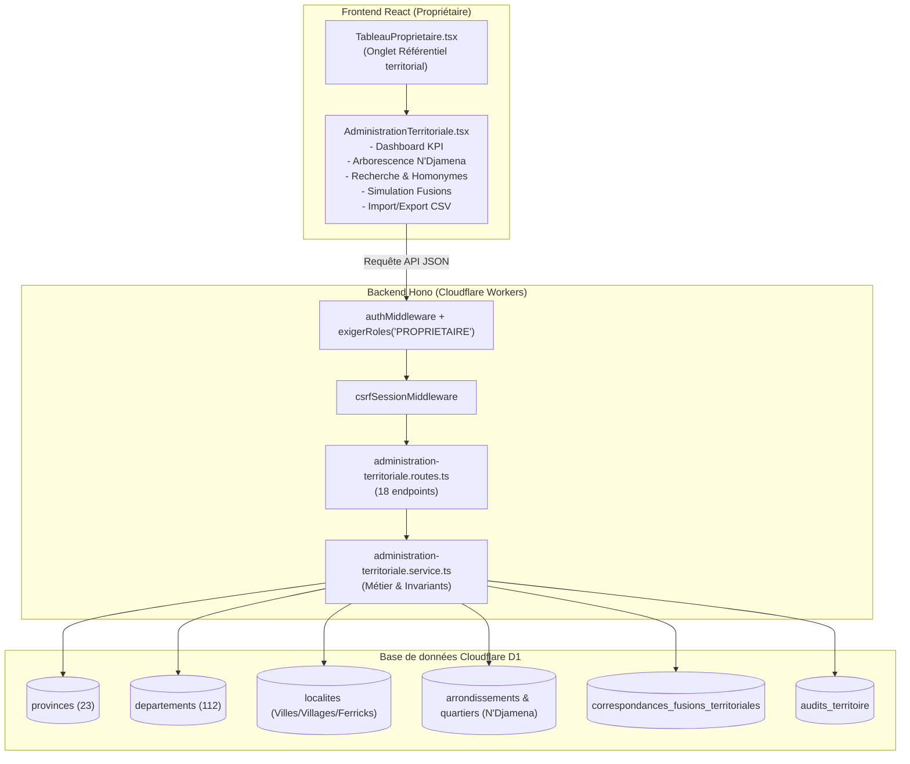

# SIGAD — ARCHITECTURE TECHNIQUE DU MODULE D'ADMINISTRATION TERRITORIALE
## Conception système, modèle relationnel D1 et ergonomie de gouvernance

**Date :** 25 octobre 2026  
**Version :** SIGAD 3.0.0  
**Environnement :** Cloudflare Workers + D1 SQLite + React 19 + TypeScript  
**Composants principaux :**
- Service backend : `backend/src/services/administration-territoriale.service.ts`
- Routes API : `backend/src/routes/administration-territoriale.routes.ts`
- Composant Frontend : `frontend/src/components/proprietaire/AdministrationTerritoriale.tsx`
- Migration D1 : `migrations/0032_administration_territoriale_proprietaire.sql`

---

## 1. Vue d'ensemble architecturale



---

## 2. Modèle relationnel et structures D1 (Migration 0032)

### 2.1 Extension de la table `departements`
Pour supporter la certification granulaire des 112 départements, la migration 0032 a enrichi la table `departements` avec les colonnes suivantes :
```sql
ALTER TABLE departements ADD COLUMN validation_administrative TEXT NOT NULL DEFAULT 'A_VERIFIER' CHECK (validation_administrative IN ('VALIDE', 'A_VERIFIER', 'HISTORIQUE', 'ARCHIVE'));
ALTER TABLE departements ADD COLUMN validation_rattachement TEXT NOT NULL DEFAULT 'A_VERIFIER' CHECK (validation_rattachement IN ('VALIDE', 'A_VERIFIER'));
ALTER TABLE departements ADD COLUMN validation_coordonnees TEXT NOT NULL DEFAULT 'NON_RENSEIGNE' CHECK (validation_coordonnees IN ('VALIDE', 'NON_RENSEIGNE', 'A_VERIFIER'));
ALTER TABLE departements ADD COLUMN validation_limites_cartographiques TEXT NOT NULL DEFAULT 'NON_RENSEIGNE' CHECK (validation_limites_cartographiques IN ('VALIDE', 'NON_RENSEIGNE', 'A_VERIFIER'));
ALTER TABLE departements ADD COLUMN autres_appellations TEXT;
ALTER TABLE departements ADD COLUMN date_effet TEXT;
ALTER TABLE departements ADD COLUMN reference_juridique TEXT;
ALTER TABLE departements ADD COLUMN observations TEXT;
ALTER TABLE departements ADD COLUMN latitude REAL;
ALTER TABLE departements ADD COLUMN longitude REAL;
```

### 2.2 Table `correspondances_fusions_territoriales`
Cette table conserve la traçabilité mathématique des fusions pour garantir la validité des requêtes rétrospectives sans casser l'intégrité référentielle des distributions passées :
```sql
CREATE TABLE IF NOT EXISTS correspondances_fusions_territoriales (
    id TEXT PRIMARY KEY,
    entite_type TEXT NOT NULL CHECK (entite_type IN ('DEPARTEMENT', 'SOUS_PREFECTURE', 'COMMUNE', 'CANTON', 'LOCALITE', 'ARRONDISSEMENT', 'QUARTIER', 'CARRE', 'SITE_HUMANITAIRE')),
    ancien_id TEXT NOT NULL,
    nouveau_id TEXT NOT NULL,
    motif TEXT NOT NULL,
    justificatif TEXT,
    fusionne_par TEXT NOT NULL REFERENCES utilisateurs(id),
    fusionne_le TEXT NOT NULL DEFAULT (datetime('now'))
);
CREATE INDEX IF NOT EXISTS idx_corr_fusions_ancien ON correspondances_fusions_territoriales(ancien_id);
CREATE INDEX IF NOT EXISTS idx_corr_fusions_nouveau ON correspondances_fusions_territoriales(nouveau_id);
```

### 2.3 Table `audits_territoire`
Consigne chaque action modificative avec horodatage certifié, empreinte utilisateur et clichés d'état :
```sql
CREATE TABLE IF NOT EXISTS audits_territoire (
    id TEXT PRIMARY KEY,
    action TEXT NOT NULL CHECK (action IN ('CREATION', 'MODIFICATION', 'MODIFICATION_RATTACHEMENT', 'FUSION', 'ARCHIVAGE', 'SUPPRESSION', 'VALIDATION', 'RETRAIT_VALIDATION', 'IMPORT')),
    entite_type TEXT NOT NULL,
    entite_id TEXT NOT NULL,
    utilisateur_id TEXT NOT NULL REFERENCES utilisateurs(id),
    anciennes_valeurs TEXT,
    nouvelles_valeurs TEXT,
    justificatif TEXT,
    motif TEXT,
    adresse_ip TEXT,
    cree_le TEXT NOT NULL DEFAULT (datetime('now'))
);
CREATE INDEX IF NOT EXISTS idx_audits_terr_entite ON audits_territoire(entite_type, entite_id);
CREATE INDEX IF NOT EXISTS idx_audits_terr_action ON audits_territoire(action);
CREATE INDEX IF NOT EXISTS idx_audits_terr_cree ON audits_territoire(cree_le);
```

---

## 3. Ergonomie et interface du Propriétaire

L'interface intégrée dans `frontend/src/components/proprietaire/AdministrationTerritoriale.tsx` est accessible via l'onglet dédié **`Référentiel territorial`** sous la rubrique **`Administration du système`**.

Elle s'articule en sept sous-vues interactives :
1. **Vue d'ensemble & Métriques :** Cartes statistiques en temps réel (23 provinces, 112 départements qualifiés, sous-préfectures, communes, localités, N'Djaména, unités validées et en attente).
2. **Arborescence hiérarchique :** Visualisation arborescente par province dépliable, avec isolation explicite de la structure spéciale de N'Djaména (10 arrondissements et quartiers).
3. **Recherche & Actions unitaires :** Recherche instantanée avec fil d'ariane géographique (`Province > Département > Localité`), boutons d'action rapide pour valider/rétrograder, modifier le rattachement ou supprimer de façon sécurisée.
4. **Fusions & Rapprochements :** Outil de fusion guidée avec module de simulation préalable affichant les ménages transférés, les bénéficiaires et l'absence de conflits de rattachement.
5. **Détection de doublons :** Analyse automatique des homonymes toponymiques intra-provinciaux pour proposer des rapprochements immédiats.
6. **Import / Export CSV :** Téléchargement du référentiel national au format CSV UTF-8 et moteur d'importation par lot avec prévisualisation et rapport d'erreurs avant validation.
7. **Journal d'audit :** Historique inaltérable de toutes les mutations territoriales intervenues avec auteur, date et justification.
