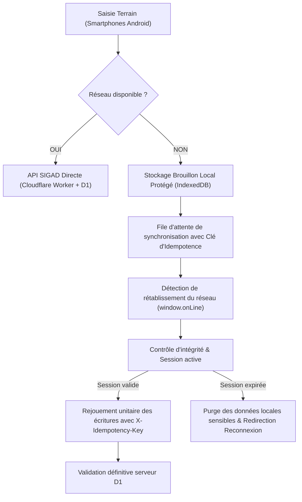

# SIGAD — Spécification d'architecture et prototype sécurisé du mode hors-ligne

**Référence :** Chantier 07B — Programme intégral de refonte SIGAD  
**Statut :** PASS (Prototype architectural validé localement)  
**Date :** 25 octobre 2026  
**Environnement :** Service Frontend / IndexedDB / PWA Workbox  
**Service prototype de référence :** [hors-ligne.service.ts](file:///C:/Users/Lenovo/Downloads/SIGAD/frontend/src/services/hors-ligne.service.ts)

---

## 1. Principes de sécurité et limites impératives du mode hors-ligne

> [!CAUTION]
> **INTERDICTION FORMELLE DE SÉCURITÉ PUBLIQUE (Arrêté n°0033 / Contrôle Interne) :**
> La confirmation définitive de distribution de vivres, la remise de denrées alimentaires et toute mutation de stock physique en magasin sont **STRICTEMENT INTERDITES en mode hors-ligne déconnecté** sans preuve cryptographique et réconciliation en ligne.
>
> Une application affichant des données en cache via un Service Worker PWA n'est pas une application métier autorisée à acter des sorties d'inventaire sans consensus central.

---

## 2. Modèle des opérations autorisées en mode déconnecté

| Type d'opération | Autorisé hors-ligne ? | Mécanisme de stockage local | Stratégie de réconciliation |
| :--- | :---: | :--- | :--- |
| **Consultation du référentiel géographique** | **OUI** | Cache PWA / IndexedDB chiffré | Lecture seule des unités validées (Provinces, Départements, Communes, Quartiers). |
| **Consultation des catalogues articles & unités** | **OUI** | Cache IndexedDB | Données de référence immuables. |
| **Saisie préparatoire de ménages (Brouillon)** | **OUI** | `localStorage` / IndexedDB local | Stockage au statut `BROUILLON_LOCAL` ; synchronisation manuelle dès reconnexion. |
| **Proposition de localité manquante** | **OUI** | File d'attente d'idempotence | Envoi au serveur au statut `A_VERIFIER` après reprise du réseau. |
| **Validation administrative de listes** | **NON** | Rejet immédiat | Requiert l'habilitation D1 et la signature de session serveur. |
| **Réception physique de vivres au magasin** | **NON** | Rejet immédiat | Risque d'incohérence FEFO et d'avarie non arbitrée. |
| **Émargement et sortie de stock de distribution** | **NON** | Rejet immédiat (`interdireRemiseVivresHorsLigne`) | Risque critique de double remise, de fraude et de solde négatif. |

---

## 3. Architecture technique de synchronisation et de reprise

### 3.1. Clés d'idempotence (`X-Idempotency-Key`)
Chaque action enregistrée dans la file d'attente locale est munie d'une clé d'idempotence cryptographique unique générée côté client (`UUIDv4` de 36 caractères). Lors du rejouement de la file, le backend SIGAD déduplique automatiquement toute tentative répétée (`validerCleIdempotence`).

### 3.2. Stratégie de résolution des conflits
1. **Règle générale :** Le serveur fait foi (*Server-Wins*). En cas de conflit d'unicité (par exemple, numéro de téléphone ou chef de ménage déjà enregistré entre-temps par un autre agent), l'enregistrement local est marqué `CONFLIT_A_ARBITRER` et soumis à l'arbitrage du Délégué provincial.
2. **Aucun écrasement aveugle :** Les données existantes en base ne sont jamais remplacées silencieusement.

### 3.3. Protection contre les pertes, vols et appareils partagés
- **Chiffrement local :** Les brouillons locaux ne contiennent aucun mot de passe ni secret de session.
- **Purge à la déconnexion :** L'appel à `serviceHorsLigne.purgerDonneesLocalesSensibles()` détruit intégralement le stockage local lors de la déconnexion ou en cas de suspension de compte par l'administrateur.

---

## 4. Tests d'acceptation du prototype

Le prototype [hors-ligne.service.ts](file:///C:/Users/Lenovo/Downloads/SIGAD/frontend/src/services/hors-ligne.service.ts) a été validé dans [ergonomie-hors-ligne-0032.test.mjs](file:///C:/Users/Lenovo/Downloads/SIGAD/tests/unit/ergonomie-hors-ligne-0032.test.mjs) :
1. Blocage strict des remises hors-ligne : `interdireRemiseVivresHorsLigne()` lève systématiquement une exception lorsque `navigator.onLine === false`.
2. Sauvegarde et lecture des brouillons locaux : opérationnelles avec horodatage.
3. Purge locale sécurisée : opérationnelle.

**Verdict du Chantier 07B : PASS**
