# Matrice des Types de Localités et Règles d'Imbrication — SIGAD

## 1. Classification des Localités et Sites

Dans la base SIGAD, chaque entité territoriale répond à des règles strictes de typologie et d'attributs obligatoires.

| Catégorie Entité | Types admis | Rôle dans l'application | Dépendance administrative directe | Attributs spécifiques |
| :--- | :--- | :--- | :--- | :--- |
| **Localité** | `VILLE` | Pôle urbain majeur ou chef-lieu | Province (obligatoire), Département (facultatif si statut particulier N'Djaména) | `mode_decoupage_urbain`: `AVEC_ARRONDISSEMENTS`, `SANS_ARRONDISSEMENT`, `AUCUN` |
| **Localité** | `VILLAGE` | Communauté rurale sédentaire | Province, Département, Sous-préfecture / Commune / Canton | `mode_decoupage_urbain`: `AUCUN` |
| **Localité** | `FERRICK` | Campement ou regroupement pastoral nomade | Province, Département, Sous-préfecture, Zone pastorale | `mode_decoupage_urbain`: `AUCUN` |
| **Localité** | `CAMPEMENT` | Établissement temporaire pastoral ou saisonnier | Province, Département, Sous-préfecture | `mode_decoupage_urbain`: `AUCUN` |
| **Arrondissement** | Division municipale | Subdivisions des grandes villes (ex. N'Djaména 1er à 10e) | Rattaché obligatoirement à une `localite` de type `VILLE` | `code`, `nom`, `commune_id` (facultatif) |
| **Quartier** | Quartier | Entité de proximité urbaine | Rattaché à une `localite` (et optionnellement à un `arrondissement`) | `possede_carres` (0 ou 1) |
| **Carré** | Carré | Subdivision fine de quartier | Rattaché obligatoirement à un `quartier` ayant `possede_carres = 1` | `code_ou_nom` |
| **Site Humanitaire** | `CAMP_REFUGIES`, `SITE_DEPLACES`, `CENTRE_ACCUEIL`, `SITE_TRANSIT`, `AUTRE_SITE` | Structure d'accueil d'urgence humanitaire | Province (obligatoire), Département (facultatif si statut particulier) | `code_site`, `localite_proche_id` (facultatif) |

## 2. Matrice d'Imbrication selon le Milieu d'Intervention

```mermaid
flowchart TD
    subgraph Urbain["Milieu URBAIN"]
        U_P["Province"] --> U_V["Ville"]
        U_V --> U_A["Arrondissement"]
        U_A --> U_Q["Quartier"]
        U_Q --> U_C["Carré"]
        U_C --> U_M["Ménage"]
    end

    subgraph Rural["Milieu RURAL SEDENTAIRE"]
        R_P["Province"] --> R_D["Département"]
        R_D --> R_SP["Sous-Préfecture / Commune"]
        R_SP --> R_CT["Canton"]
        R_CT --> R_VG["Village"]
        R_VG --> R_M["Ménage"]
    end

    subgraph Nomade["Milieu NOMADE PASTORAL"]
        N_P["Province"] --> N_D["Département"]
        N_D --> N_SP["Sous-Préfecture"]
        N_SP --> N_FK["Ferrick / Campement"]
        N_FK --> N_M["Ménage"]
    end

    subgraph Humanitaire["Milieu SITE HUMANITAIRE"]
        H_P["Province"] --> H_D["Département (optionnel)"]
        H_D --> H_SH["Site Humanitaire (Camp / PDI)"]
        H_SH --> H_BL["Bloc / Secteur"]
        H_BL --> H_M["Ménage"]
    end
```

## 3. Contrôles d'Intégrité par Déclencheurs SQLite/D1

1. **Localité vers Province / Département** :
   Le déclencheur `verifier_localite_avant_insertion` vérifie que si `departement_id` est renseigné, il appartient à la même province. Si `departement_id` est NULL, l'opération est autorisée pour les provinces à statut particulier (`statut_particulier = 1`, N'Djaména).
2. **Cohérence des Quartiers et Arrondissements** :
   Le quartier doit appartenir à la localité renseignée et être aligné avec l'arrondissement s'il est spécifié.
3. **Condition des Carrés** :
   Un carré ne peut être inséré ou rattaché que si le quartier parent possède l'indicateur `possede_carres = 1`.
4. **Sites Humanitaires** :
   Les sites humanitaires vérifient la cohérence de leur province et de la localité proche de rattachement.
