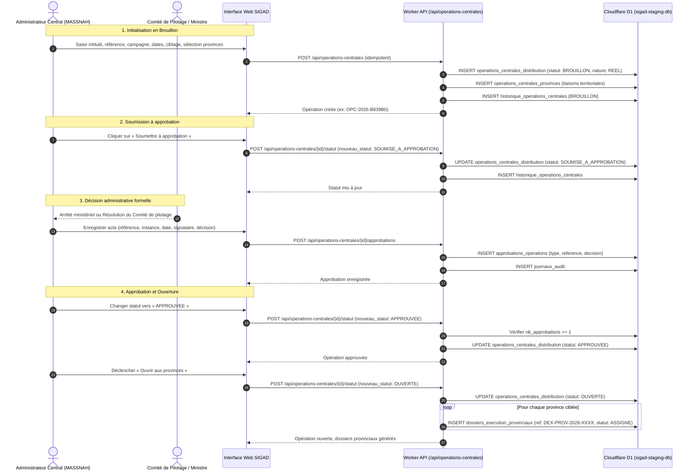
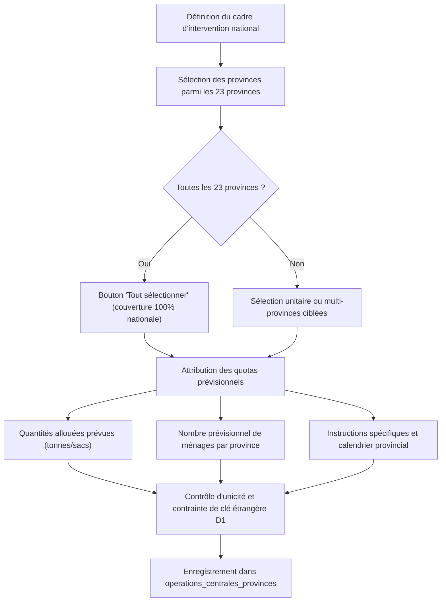
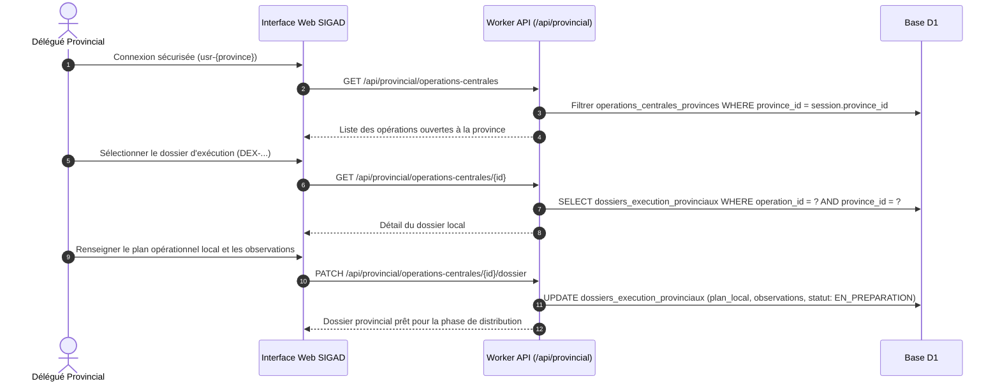
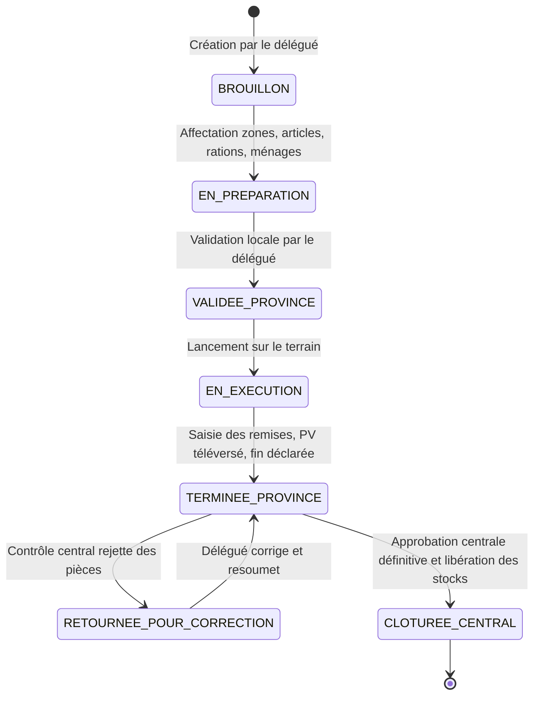
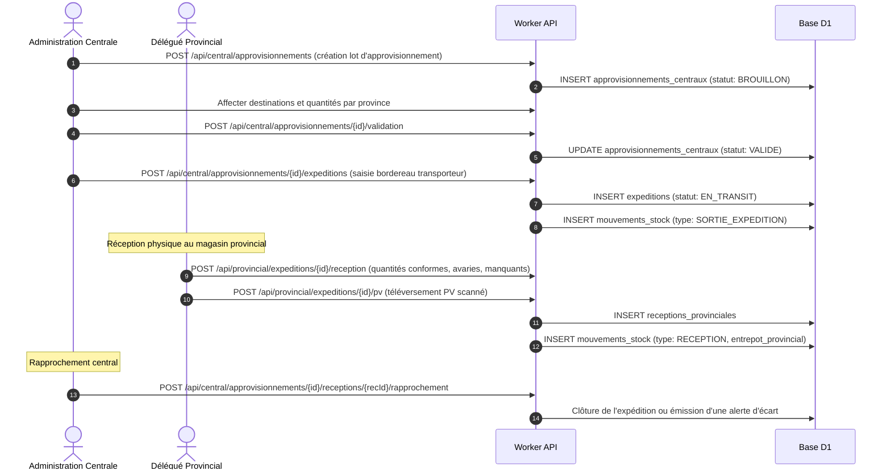
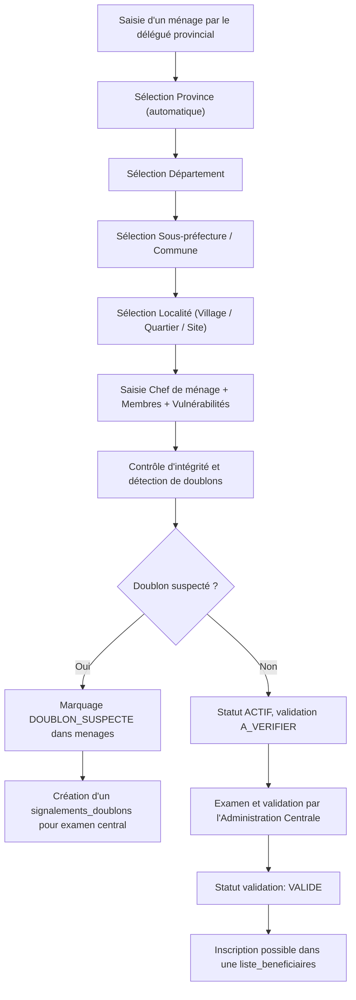
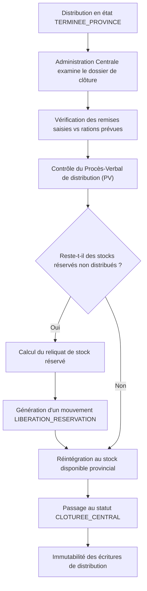
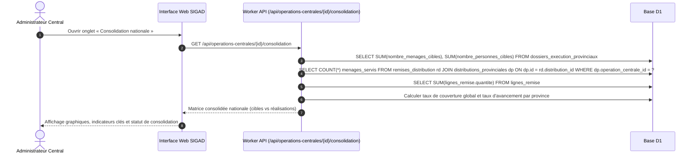
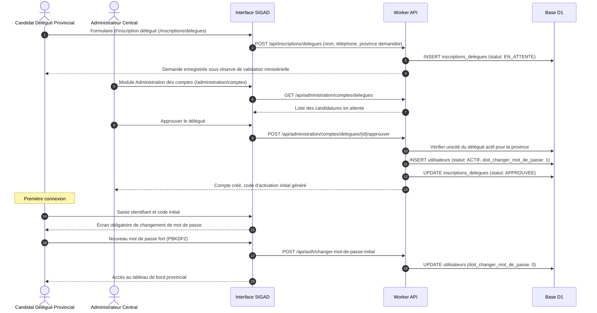
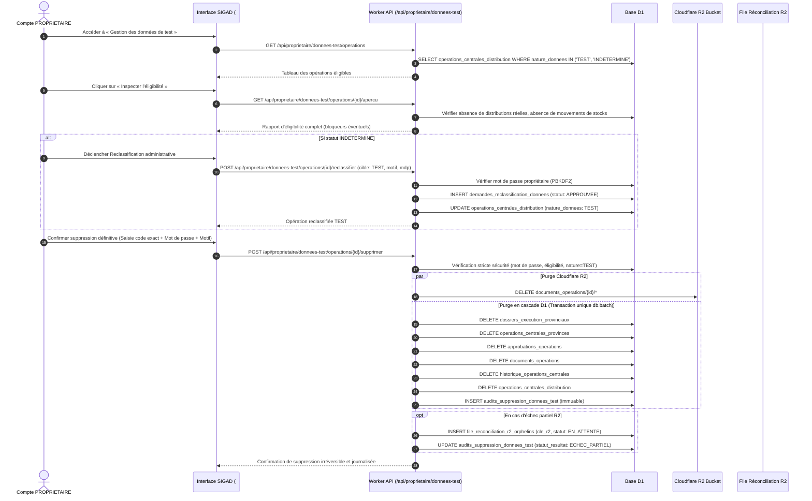

# SIGAD — PARCOURS OPÉRATIONNELS ET FLUX FONCTIONNELS
## Modélisation des processus métier du Système Intégré de Gestion des Aides et des Distributions

**Environnement audité :** Cloudflare Staging (`https://sigad-staging.reemtech0412.workers.dev`)  
**Version Worker active :** `0c020f68-17c5-47ee-aa20-7478aa8a27b2`  
**Base D1 :** `sigad-staging-db` (27 migrations, 85 tables)  
**Date d'audit :** 25 octobre 2026  
**Référence réglementaire :** Arrêté n°0033/PR/PM/MASSNAH/SG/2026 du 7 octobre 2026

---

## 1. Création et validation d'une opération centrale

Ce flux décrit la création administrative d'une opération centrale par le Ministère de l'Action Sociale (MASSNAH), sa soumission pour examen, son approbation formelle et son ouverture opérationnelle.

---

## 2. Choix et affectation territoriale des provinces

Ce flux détaille la répartition des prévisions nationales et des consignes par délégation provinciale.

---

## 3. Prise en charge et exécution provinciale

Ce flux illustre comment le délégué provincial accède à l'opération centrale et instruit son dossier local.

---

## 4. Cycle complet d'une distribution effective

Ce flux montre la mise en œuvre d'une distribution provinciale, de sa préparation à sa clôture administrative.

---

## 5. Approvisionnement central et gestion des stocks

Ce flux décrit le circuit logistique amont entre l'ONASA/Partenaires et les entrepôts provinciaux.

---

## 6. Enregistrement, ciblage et contrôle des ménages bénéficiaires

Ce flux montre comment les bénéficiaires sont enregistrés, dédoublonnés et validés.

---

## 7. Rapprochement et libération des stocks en clôture

Ce flux illustre le contrôle strict des stocks avant la fermeture définitive d'une distribution.

---

## 8. Consolidation nationale d'une opération centrale

Ce flux montre comment les résultats de toutes les provinces ciblées sont synthétisés à l'échelle nationale.

---

## 9. Gestion des comptes, habilitations et cycle MFA

Ce flux décrit l'enrôlement et la sécurisation des accès des délégués et administrateurs.

---

## 10. Gestion et purge sécurisée des données de test (Compte PROPRIÉTAIRE)

Ce flux détaille la nouvelle procédure rigoureuse de nettoyage réservée exclusivement au Propriétaire du système.

