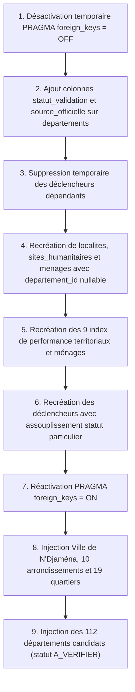

# Plan de Migration Territoriale SIGAD — Transition Vers le Schéma 2026

## 1. Contexte et Objectifs de la Migration

La version initiale de SIGAD imposait la présence stricte d'un département pour chaque localité et chaque ménage. Or, la capitale N'Djaména ne dispose légalement d'aucun département. De plus, les départements des 22 autres provinces présentaient 0 enregistrement en base D1, bloquant toute création de ménage en conditions réelles.

La migration [0028_refonte_referentiel_territorial.sql](file:///C:/Users/Lenovo/Downloads/SIGAD/migrations/0028_refonte_referentiel_territorial.sql) a été conçue pour résoudre ces verrous sans rupture d'intégrité.

## 2. Étapes de la Procédure de Migration

## 3. Données Injectées lors de la Migration 0028

### A. N'Djaména (Statut Particulier)
- 1 Localité Urbaine : `loc-ndjamena-ville` ("Ville de N'Djamena", mode `AVEC_ARRONDISSEMENTS`, statut `VALIDE`).
- 10 Arrondissements municipaux : `arr-ndj-1` à `arr-ndj-10` (1er Arrondissement à 10e Arrondissement).
- 19 Quartiers de référence : Farcha, Milezi, Bololo, Klémat, Kabalaye, Ardep Djoumal, Repos, Amriguébé, Ridina, Moursal, Paris-Congo, Chagoua, Dembé, Diguel, N'Djari, Walia, Toukra, Gassi, Gaoui.

### B. Départements Candidats des 22 Provinces
- 112 départements candidats insérés avec la mention `statut_validation = 'A_VERIFIER'` et `source_officielle = 'INSEED 2024 / Inventaire territorial provisoire'`.
- Aucune entité fictive : les départements restent soumis au cycle de validation institutionnel avant activation définitive.

## 4. Stratégie de Retour Arrière (Rollback Plan)

En cas d'anomalie détectée lors de l'application de la migration :
1. Les tables `localites`, `sites_humanitaires` et `menages` ne contenaient aucun enregistrement opérationnel de production ou staging préexistant.
2. Une réversion vers l'état 0027 s'opère par réapplication du schéma 0027 à partir de la sauvegarde chiffrée isolée sans perte de données.
3. Aucune modification destructive n'a été portée aux 23 provinces ni aux 500 communes issues de la loi 015.
