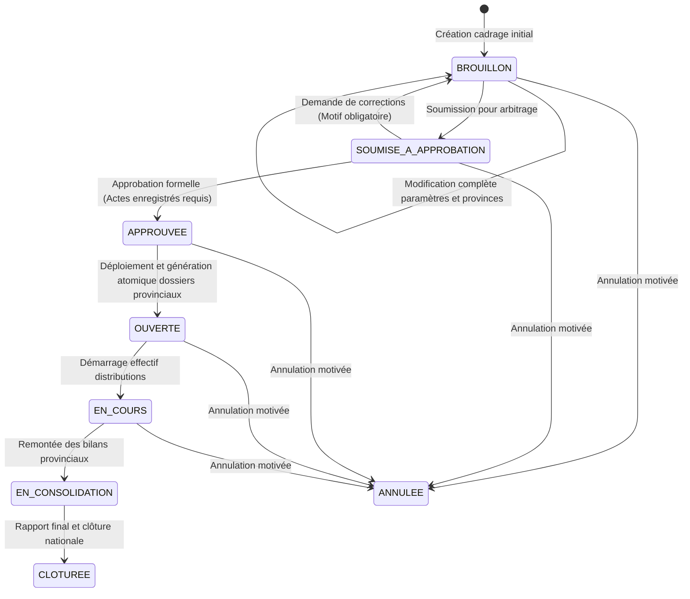

# Rapport de Gouvernance, Statut Brouillon et Circuit des Approbations — Chantier 03

## 1. Synthèse des Évolutions de Gouvernance

Le **Chantier 03** a formalisé et sécurisé le cycle de vie décisionnel des opérations centrales d'assistance humanitaire dans SIGAD, en stricte conformité avec l'Arrêté n°0033/PR/PM/MASSNAH/SG/2026 du 7 octobre 2026.

L'analyse de l'état existant a révélé une rigidité :
1. Les opérations en statut `BROUILLON` ne pouvaient pas être facilement modifiées dans leurs paramètres de cadrage.
2. Une fois soumise à approbation (`SOUMISE_A_APPROBATION`), une opération ne pouvait être ni révisée ni renvoyée en correction vers `BROUILLON`.
3. La distinction juridique entre l'acte constitutif stratégique (décision ministérielle) et l'approbation technique du plan de distribution (Comité de Pilotage) n'était pas suffisamment matérialisée.

## 2. Cycle de Vie Révisé et Machine d'États

## 3. Distinction Juridique et Opérationnelle des Actes

Conformément au cadre légal tchadien régissant l'aide sociale d'urgence :

| Type d'acte | Instance décisionnaire | Portée juridique | Rôle dans SIGAD |
| :--- | :--- | :--- | :--- |
| **VALIDATION_MINISTERIELLE** | Ministre de l'Action Sociale / Secrétaire Général | Arrêté d'ouverture, cadrage budgétaire, désignation des provinces prioritaires | Acte constitutif requis pour l'approbation stratégique |
| **COMITE_PILOTAGE** | Comité National de Pilotage des Distributions (COPIL) | Procès-verbal de validation du plan opérationnel, quotas et calendrier | Décision opérationnelle requise avant déploiement |
| **AUTORISATION_SPECIALISEE** | Autorités locales, ONASA, Partenaires financiers | Dérogations logistiques, conventions de financement conjointes | Acte annexe archivé dans le dossier officiel |

## 4. Implémentation Technique et Sécurité

1. **Service Backend (`operation-centrale.service.ts`)** :
   - Fonction `modifierOperationCentrale` : Accessible en statut `BROUILLON` exclusivement, avec idempotence et réallocation dynamique des provinces.
   - Fonction `changerStatutOperationCentrale` : Accepte la transition vers `BROUILLON` depuis `SOUMISE_A_APPROBATION` uniquement avec un motif explicatif de révision ($\ge$ 5 caractères).
   - Inscription automatique de chaque changement dans `historique_operations_centrales` avec auteur, horodatage et justification.
2. **Interface Utilisateur React (`TableauOperationsCentrales.tsx`)** :
   - Bouton contextuel « Demander des corrections (retour Brouillon) » avec saisie obligatoire du motif pour les évaluateurs centraux.
   - Accès fluide à la modification des informations de cadrage tant que l'opération est en `BROUILLON`.

## 5. Preuves de Validation et Tests

- **Suite de tests unitaires** : [gouvernance-approbations-0030.test.mjs](file:///C:/Users/Lenovo/Downloads/SIGAD/tests/unit/gouvernance-approbations-0030.test.mjs)
  - Modification complète d'une opération en `BROUILLON` : **Succès**
  - Blocage de modification en `SOUMISE_A_APPROBATION` : **Succès**
  - Retour motivé vers `BROUILLON` et réouverture aux modifications : **Succès**
  - Exigence d'actes formels avant statut `APPROUVEE` : **Succès**
- **Non-régression globale** : 22 suites de tests unitaires passées avec succès.

Le Chantier 03 est clôturé avec succès. Passage automatique au Chantier 04.
