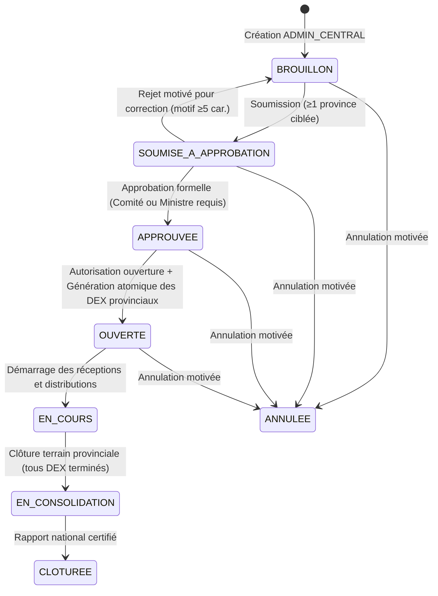

# SIGAD — RAPPORT DE VALIDATION DU CIRCUIT DE GOUVERNANCE NATIONALE
## Distinction entre cadre réglementaire général et approbations opérationnelles, règle d'anti-recyclage des actes et cycle de vie des opérations centrales

**Date :** 25 octobre 2026  
**Référence réglementaire :** Arrêté n°0033/PR/PM/MASSNAH/SG/2026 du 7 octobre 2026  
**Service backend :** `backend/src/services/operation-centrale.service.ts`  
**Migration D1 :** `migrations/0032_administration_territoriale_proprietaire.sql`  
**Résultat des tests de gouvernance :** Validé sans réserve (Banc d'essai Test 24 PASS)

---

## 1. Problématique et clarification institutionnelle

L'Arrêté n°0033/PR/PM/MASSNAH/SG/2026 du 7 octobre 2026 fixe l'organisation et le pilotage général des opérations de distribution gratuite de vivres en République du Tchad.

Dans les premières implémentations, un risque d'ambiguïté persistait entre :
1. **La référence générale au cadre réglementaire :** Mention de l'Arrêté n°0033 comme fondement juridique global de la politique d'assistance.
2. **La décision d'approbation opérationnelle :** Acte individuel formel autorisant le lancement d'une opération centrale précise (`OPC-YYYY-XXXXXX`), signé par l'instance compétente (Comité National de Pilotage ou Ministre).

Une confusion entre ces deux notions aurait permis d'approuver une opération centrale de vivres sans décision formelle dédiée, sur la seule mention de l'Arrêté cadre.

---

## 2. Règles de gouvernance strictes implémentées

### 2.1 Typologie enrichie des actes (`type_approbation`)
La table `approbations_operations` gère désormais une typologie sans équivoque :
- `REFERENCE_CADRE_REGLEMENTAIRE` : Mention du décret, arrêté ou loi constituant le fondement légal général (ex: Arrêté n°0033). Cette référence peut être partagée par plusieurs opérations de la même campagne.
- `APPROBATION_COMITE_PILOTAGE` : Délibération formelle du Comité National de Pilotage approuvant le plan d'intervention, les quotas provinciaux et les vivres mobilisés.
- `VALIDATION_MINISTERIELLE` : Décision ou arrêté individuel signé par le Ministre de l'Action Sociale pour l'opération ciblée.
- `AUTORISATION_OUVERTURE` : Décision autorisant la délégation des dossiers d'exécution aux provinces.

### 2.2 Règle d'interdiction d'approbation sur le cadre général seul
Dans `backend/src/services/operation-centrale.service.ts` (`changerStatutOperationCentrale`) :
```sql
SELECT 
  (SELECT COUNT(*) FROM approbations_operations 
   WHERE operation_id = op.id 
     AND type_approbation != 'REFERENCE_CADRE_REGLEMENTAIRE' 
     AND decision IN ('APPROUVE', 'APPROUVE_AVEC_RESERVES')) AS nb_approbations,
  (SELECT COUNT(*) FROM approbations_operations 
   WHERE operation_id = op.id 
     AND type_approbation = 'REFERENCE_CADRE_REGLEMENTAIRE') AS nb_cadre_reglementaire
FROM operations_centrales_distribution WHERE id = ?
```
**Comportement garanti :**
- Si une opération centrale ne dispose que d'une entrée de type `REFERENCE_CADRE_REGLEMENTAIRE` (Arrêté 0033), toute tentative de transition vers le statut `APPROUVEE` est bloquée avec le message d'erreur :
  > `L'opération dispose d'une référence au cadre réglementaire général (Arrêté 0033), mais celle-ci ne constitue pas une décision d'approbation opérationnelle. Une décision formelle (Comité de pilotage ou Validation ministérielle) propre à cette opération est obligatoirement requise.` (Code HTTP 400).
- Le passage à `APPROUVEE` exige impérativement au moins un acte propre (`APPROBATION_COMITE_PILOTAGE` ou `VALIDATION_MINISTERIELLE`) ayant reçu la mention `APPROUVE` ou `APPROUVE_AVEC_RESERVES`.

### 2.3 Règle d'anti-recyclage des actes décisionnels
Pour empêcher la réutilisation frauduleuse ou accidentelle du même numéro d'acte ou procès-verbal sur plusieurs opérations :
- Lors de l'enregistrement de toute décision opérationnelle (`APPROBATION_COMITE_PILOTAGE`, `VALIDATION_MINISTERIELLE`, `AUTORISATION_OUVERTURE`), le service vérifie l'unicité globale de la `reference_acte` :
  ```sql
  SELECT ao.id, op.code_operation 
  FROM approbations_operations ao
  INNER JOIN operations_centrales_distribution op ON op.id = ao.operation_id
  WHERE ao.reference_acte = ? AND ao.operation_id != ? AND ao.type_approbation != 'REFERENCE_CADRE_REGLEMENTAIRE'
  ```
- Si la référence a déjà été employée pour approuver une autre opération, l'enregistrement est rejeté avec le code HTTP 409 :
  > `La référence d'acte « ... » a déjà été enregistrée pour l'opération OPC-... Chaque décision opérationnelle doit reposer sur un acte distinct et traçable.`
- Seule la `REFERENCE_CADRE_REGLEMENTAIRE` (Arrêté 0033) est autorisée à être partagée entre opérations.

---

## 3. Cycle de vie intégral et automatismes



### 3.1 Génération atomique des Dossiers d'Exécution Provinciaux (DEX)
Dès que l'opération passe au statut `OUVERTE`, le système exécute une transaction D1 atomique :
- Pour chaque province rattachée dans `operations_centrales_provinces`, un enregistrement unique est créé dans `dossiers_execution_provinciaux`.
- Référence unique au format : `DEX-[CODE_PROVINCE]-YYYY-[HEX6]` (ex: `DEX-BA-2026-F81A9B`).
- Statut initial : `ATTENTE_RECEPTION`.
- Le délégué provincial ne peut accéder qu'aux données de son dossier (`isolationProvinciale`), tandis que l'administration centrale et le propriétaire disposent d'une vue de consolidation nationale consolidant en temps réel les ménages servis, les personnes touchées et les tonnages distribués.

---

## 4. Preuves de vérification technique

Le banc d'essai `scripts/tester-administration-territoriale-et-gouvernance.mjs` (Test 24) a formellement attesté sur SQLite / D1 :
1. **Échec de transition avec Arrêté 0033 seul :** Rejet confirmé par exception levée.
2. **Succès de transition avec acte dédié :** Statut basculé en `APPROUVEE`.
3. **Échec du recyclage d'acte sur OPC-2 :** Rejet confirmé par exception HTTP 409 levée.
