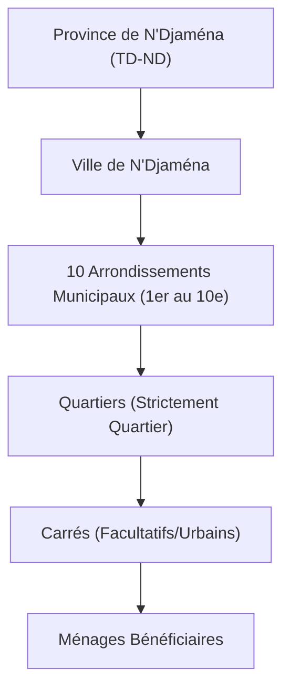

# Référentiel Territorial SIGAD — Architecture Révisée 2026

## 1. Principes Fondamentaux et Cadre Réglementaire

Le référentiel territorial du Système Intégré de Gestion des Aides et des Distributions (SIGAD) a été restructuré pour refléter fidèlement la réalité institutionnelle et administrative de la République du Tchad, conformément aux dispositions de :
- L’Ordonnance n°002/PR/2024 et la Loi Organique n°015/CNT/2024 portant statut des collectivités autonomes ;
- L'Arrêté n°0033/PR/PM/MASSNAH/SG/2026 du 7 octobre 2026 relatif au pilotage des opérations d'assistance alimentaire ;
- Les données statistiques officielles de l’INSEED (Annuaire statistique national du Tchad, éditions 2023 et 2024).

## 2. Découpage Administratif et Hiérarchie Territoriale

### A. Statut Particulier de la Capitale N'Djaména
La province de N'Djaména bénéficie d'un statut institutionnel particulier (`statut_particulier = 1`) qui ne comporte **aucun département ni sous-préfecture** :

### B. Provinces Ordinaires (22 Provinces)
Pour l'ensemble des 22 autres provinces, la chaîne hiérarchique s'organise selon les niveaux suivants :
1. **Province** : Circonscription administrative provinciale majeure (23 au total national).
2. **Département** : Niveau intermédiaire (112 départements candidats recensés, statut initial `A_VERIFIER`).
3. **Sous-Préfecture / Commune** : Circonscriptions déconcentrées et collectivités décentralisées (500 communes de la Loi 015 en statut `PROPOSE` pour audit/activation progressive).
4. **Canton** : Regroupement coutumier ou chefferie traditionnelle.
5. **Localité de base** : Ville, Village, Ferrick ou Campement.
6. **Sites Humanitaires** : Camps de réfugiés, sites de déplacés internes, centres d'accueil ou de transit rattachés à la hiérarchie provinciale.

## 3. Les 4 Milieux d'Intervention Opérationnels

Pour répondre aux contextes opérationnels variés du Tchad, SIGAD formalise 4 milieux d'intervention :

| Milieu d'intervention | Unités territoriales mobilisées | Type de population ciblée | Particularités opérationnelles |
| :--- | :--- | :--- | :--- |
| **URBAIN** | Province $\rightarrow$ Ville $\rightarrow$ Arrondissement $\rightarrow$ Quartier $\rightarrow$ Carré | Ménages citadins, vulnérables urbains, déplacés en ville | Adressage par carré ou quartier, terminologie normalisée |
| **RURAL_SEDENTAIRE** | Province $\rightarrow$ Département $\rightarrow$ Sous-préfecture $\rightarrow$ Canton $\rightarrow$ Village | Agriculteurs, agro-pasteurs, populations autochtones | Rattachement aux cantons et villages sédentaires |
| **NOMADE_PASTORAL** | Province $\rightarrow$ Département $\rightarrow$ Sous-préfecture $\rightarrow$ Ferrick / Campement | Éleveurs transhumants, pasteurs nomades | Mobilité saisonnière, identification des campements et ferricks |
| **SITE_HUMANITAIRE** | Province $\rightarrow$ (Département) $\rightarrow$ Site humanitaire $\rightarrow$ Bloc/Secteur | Réfugiés, retournés, déplacés internes (PDI) | Cartographie des camps officiels, coordination HCR/CNARR |

## 4. Normalisation Terminologique
Toutes les références ambiguës ou dialectales telles que `HARA`, `Hara` ou `Quartier / Hara` ont été strictement éliminées de la base de données, du schéma et des interfaces utilisateur au profit exclusif du terme réglementaire républicain **Quartier**.

## 5. Fichiers et Composants Clés
- Migration D1/SQLite : [0028_refonte_referentiel_territorial.sql](file:///C:/Users/Lenovo/Downloads/SIGAD/migrations/0028_refonte_referentiel_territorial.sql)
- Schémas Zod : [beneficiaires.ts](file:///C:/Users/Lenovo/Downloads/SIGAD/shared/validations/beneficiaires.ts), [territoire.ts](file:///C:/Users/Lenovo/Downloads/SIGAD/shared/validations/territoire.ts)
- Types TypeScript : [territoire.ts](file:///C:/Users/Lenovo/Downloads/SIGAD/shared/types/territoire.ts)
- Sélecteur React Dynamique : [SelecteurLocalisationDynamique.tsx](file:///C:/Users/Lenovo/Downloads/SIGAD/frontend/src/components/territoire/SelecteurLocalisationDynamique.tsx)
