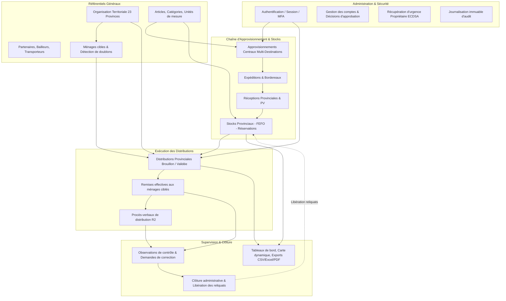
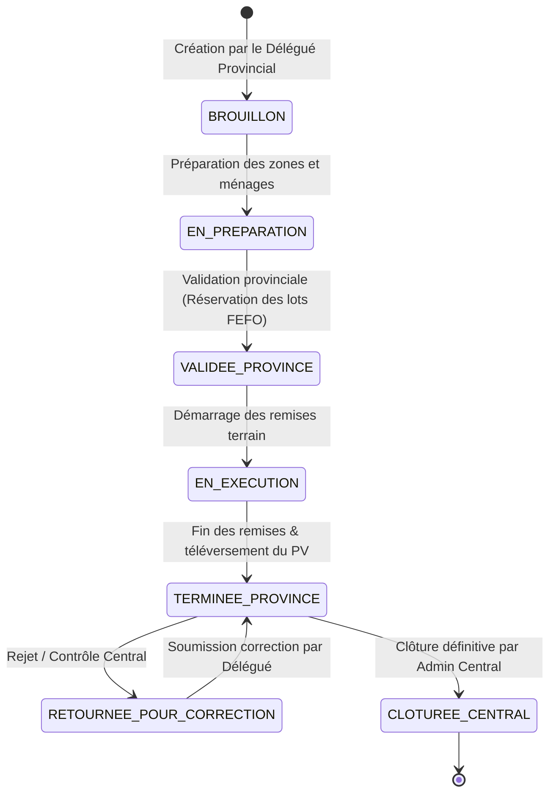

# SIGAD — ÉTAT DES LIEUX TECHNIQUE ET FONCTIONNEL DU PROJET EXISTANT
## Audit d'architecture, analyse du code source, de la base D1 et des processus opérationnels

**Projet :** SIGAD — Système Intégré de Gestion des Aides et des Distributions (République du Tchad)  
**Version logicielle :** `3.0.0`  
**Date d'audit :** 24 octobre 2026  
**Fuseau horaire de référence :** `Africa/Ndjamena` (UTC+1)  
**Statut de l'intervention :** Audit technique et fonctionnel préalable — Aucune modification du code source ni de la base de données.

---

## 1. Présentation générale du projet

Le projet **SIGAD (Système Intégré de Gestion des Aides et des Distributions)** est une plateforme logicielle intégrée conçue pour planifier, exécuter, tracer et auditer les opérations d'assistance humanitaire et sociale en République du Tchad.

### 1.1 Périmètre opérationnel
La plateforme couvre :
1. L'organisation territoriale tchadienne (23 provinces, départements, sous-préfectures, communes, cantons, localités urbaines et rurales, sites humanitaires).
2. La gestion administrative des utilisateurs et la sécurité multi-niveaux avec isolation provinciale stricte.
3. Le ciblage, le recensement, la vérification et la prévention des doublons de ménages bénéficiaires.
4. La chaîne d'approvisionnement centrale (achats, dons de partenaires, stocks centraux, expéditions multi-destinations).
5. La gestion fine des stocks d'entrepôts avec traçabilité par lots et allocation selon la règle **FEFO** (*First Expired, First Out*).
6. Les distributions provinciales de vivres et biens non alimentaires (NFI) aux ménages.
7. Le contrôle indépendant, les demandes de correction et la clôture administrative centrale.
8. La restitution décisionnelle (tableaux de bord, indicateurs cartographiques, rapports analytiques exportables en CSV, Excel et PDF).

### 1.2 Conventions structurantes
- **Langue unique :** L'intégralité de l'application (interfaces React, endpoints API Hono, schémas de validation Zod, tables et colonnes SQLite/D1, journaux d'audit et messages d'erreur) est strictement rédigée en **français**.
- **Fuseau horaire et localisation :** Dates manipulées au format ISO (`AAAA-MM-JJ` ou ISO 8601 UTC) et restituées dans le fuseau `Africa/Ndjamena`. Nombres formatés selon l'usage francophone.
- **Principe d'immutabilité et non-suppression :** Aucune suppression physique (`DELETE`) sur les données métier. Toute annulation ou régularisation s'effectue par statut ou mouvement compensatoire avec traçabilité dans `journaux_audit` et `historique_statuts`.
- **Idempotence stricte :** Toutes les mutations sensibles (créations, remises de vivres, réceptions, validations) requièrent l'en-tête HTTP `X-Idempotency-Key` (table `cles_idempotence`).

---

## 2. Architecture technique réelle

### 2.1 Stack technologique constatée
- **Backend Runtime :** Cloudflare Workers avec environnement `nodejs_compat` (`compatibility_date = "2026-10-22"`).
- **Framework HTTP Backend :** Hono `4.13.13` (`backend/src/index.ts`).
- **Validation déclarative :** Zod `4.6.7` (schémas stricts dans `shared/validations/`).
- **Base de données principale :** Cloudflare D1 (SQLite distribué, transactions atomiques via `c.env.DB.batch([...])`).
- **Stockage objet de documents :** Cloudflare R2 (`BUCKET` lié à `sigad-documents`).
- **Frontend SPA :** React `19.3.0`, React-DOM `19.3.0`, Vite `8.3.5`, TypeScript `7.0.2`, Tailwind CSS `4.3.3`, Plugin PWA `vite-plugin-pwa 2.0.0`.
- **Chiffrement et sécurité cryptographique :** Web Crypto API native (SubtleCrypto), PBKDF2-SHA256 (310 000 itérations), HMAC-SHA256 pour les jetons de session et OTP, ECDSA P-256 pour la procédure de récupération propriétaire.

### 2.2 Fichiers de configuration et environnements
- [`package.json`](file:///C:/Users/Lenovo/Downloads/SIGAD/package.json) : Scripts de test, build, vérification de type et maintenance locale.
- [`wrangler.toml`](file:///C:/Users/Lenovo/Downloads/SIGAD/wrangler.toml) : Configuration de production / développement local par défaut. D1 `sigad-base` (`0cc2b4ec-bd2d-47ad-b804-42889957d1dc`), R2 `sigad-documents`, assets statiques vers `frontend/dist`.
- [`wrangler.staging.toml`](file:///C:/Users/Lenovo/Downloads/SIGAD/wrangler.staging.toml) : Environnement Staging Cloudflare Workers (`sigad-staging`), D1 `sigad-staging-db` (`a54e1ea9-c49a-4729-ad06-a40ceb421127`), R2 `sigad-staging-documents`, distribution d'e-mails désactivée (`EMAIL_DELIVERY_ENABLED = "false"`), clé publique opérateur DPAPI configurée.
- [`wrangler.integration.toml`](file:///C:/Users/Lenovo/Downloads/SIGAD/wrangler.integration.toml) : Environnement d'intégration local automatisé avec service mock d'e-mail (`sigad-email-mock`).

### 2.3 Cheminement complet d'une action métier
```
┌─────────────────────────────────────────────────────────────────────────────────┐
│ 1. Interface Utilisateur (React 19 / Vite SPA)                                   │
│    Formulaire de saisie -> Validation locale -> En-têtes X-CSRF-Token et        │
│    X-Idempotency-Key -> Envoi via requeteApi() (frontend/src/services/api.ts)  │
└────────────────────────────────────────┬────────────────────────────────────────┘
                                         │ Requête HTTP (Cookie de session sigad_session)
                                         ▼
┌─────────────────────────────────────────────────────────────────────────────────┐
│ 2. Pipeline Middleware Worker (backend/src/index.ts)                            │
│    a. En-têtes de sécurité HTTP (CSP, HSTS, X-Frame-Options, no-store)          │
│    b. authMiddleware -> Vérification HMAC du cookie de session, extraction D1   │
│    c. csrfSessionMiddleware -> Concordance jeton de session / en-tête           │
│    d. isolationProvinciale / exigerRoles -> RBAC et cloisonnement territorial  │
└────────────────────────────────────────┬────────────────────────────────────────┘
                                         │ Context Hono typé (c.get('utilisateur'))
                                         ▼
┌─────────────────────────────────────────────────────────────────────────────────┐
│ 3. Route Hono & Service Métier (backend/src/services/)                          │
│    Ex: distribution.service.ts, stock.service.ts, approvisionnement.service.ts   │
│    a. Contrôle d'idempotence (rejouer si déjà exécuté)                          │
│    b. Vérification des contraintes métier & calculs FEFO                        │
│    c. Génération des instructions SQL batch préparées                           │
└────────────────────────────────────────┬────────────────────────────────────────┘
                                         │ Instructions D1PreparedStatement[]
                                         ▼
┌─────────────────────────────────────────────────────────────────────────────────┐
│ 4. Persistance Atomique Cloudflare D1 & R2                                      │
│    a. db.batch([...]) -> Exécution transactionnelle unitaire dans SQLite         │
│    b. Triggers SQL d'intégrité (mouvements stocks, transitions de statuts)      │
│    c. Inscription dans cles_idempotence & journaux_audit                        │
│    d. Upload binaire éventuel sur R2 Bucket (PV, pièces jointes)                │
└────────────────────────────────────────┬────────────────────────────────────────┘
                                         │ Succès HTTP 200 / 201
                                         ▼
┌─────────────────────────────────────────────────────────────────────────────────┐
│ 5. Réponse Client & Mise à jour d'état React                                    │
│    En-tête Idempotency-Replayed -> Parsing JSON -> Notification utilisateur    │
└─────────────────────────────────────────────────────────────────────────────────┘
```

---

## 3. Cartographie des principaux répertoires

| Répertoire | Description et contenu vérifié |
|---|---|
| [`backend/src/`](file:///C:/Users/Lenovo/Downloads/SIGAD/backend/src) | Cœur de l'API Cloudflare Worker (Hono). Contient `index.ts`, `bindings.ts`, et les sous-dossiers `middlewares/`, `routes/`, `services/`. |
| [`backend/src/middlewares/`](file:///C:/Users/Lenovo/Downloads/SIGAD/backend/src/middlewares) | Middlewares de sécurité : [`auth.middleware.ts`](file:///C:/Users/Lenovo/Downloads/SIGAD/backend/src/middlewares/auth.middleware.ts), [`csrf.middleware.ts`](file:///C:/Users/Lenovo/Downloads/SIGAD/backend/src/middlewares/csrf.middleware.ts), [`rbac.middleware.ts`](file:///C:/Users/Lenovo/Downloads/SIGAD/backend/src/middlewares/rbac.middleware.ts), [`audit.middleware.ts`](file:///C:/Users/Lenovo/Downloads/SIGAD/backend/src/middlewares/audit.middleware.ts). |
| [`backend/src/routes/`](file:///C:/Users/Lenovo/Downloads/SIGAD/backend/src/routes) | Routeurs Hono : `auth.routes.ts`, `comptes.routes.ts`, `utilisateurs.routes.ts`, `territoire.routes.ts`, `gestion.routes.ts`, `stocks.routes.ts`, `approvisionnements.routes.ts`, `distributions.routes.ts`, `controle.routes.ts`, `rapports.routes.ts`, `validation-territoire.routes.ts`. |
| [`backend/src/services/`](file:///C:/Users/Lenovo/Downloads/SIGAD/backend/src/services) | 19 services métier découplés (stocks FEFO, idempotence, distributions, approvisionnements, rapports export, cryptographie, MFA, récupération propriétaire, etc.). |
| [`frontend/src/`](file:///C:/Users/Lenovo/Downloads/SIGAD/frontend/src) | Application React SPA : Composant racine [`App.tsx`](file:///C:/Users/Lenovo/Downloads/SIGAD/frontend/src/App.tsx), sous-dossiers `components/` (`administration/`, `connexion/`, `gestion/`, `pilote/`, `proprietaire/`, `territoire/`), `services/api.ts`, `utils/`. |
| [`shared/`](file:///C:/Users/Lenovo/Downloads/SIGAD/shared) | Code partagé frontend/backend : constantes (`roles.ts`, `provinces.ts`), types TS (`authentification.ts`, `territoire.ts`), validateurs Zod (`approvisionnements.ts`, `distributions.ts`, `stocks.ts`, etc.). |
| [`migrations/`](file:///C:/Users/Lenovo/Downloads/SIGAD/migrations) | 25 fichiers de migration SQL ordonnés chronologiquement pour Cloudflare D1 (`0001` à `0025`). |
| [`scripts/`](file:///C:/Users/Lenovo/Downloads/SIGAD/scripts) | Scripts d'outillage : préparation de base locale, vérification de schéma, matrice de sécurité, gestion du coffre DPAPI de récupération propriétaire. |
| [`docs/`](file:///C:/Users/Lenovo/Downloads/SIGAD/docs) | Documentation d'architecture, rapports d'acceptation par phases (Phases 1 à 12), matrices de sécurité API. |
| [`tests/`](file:///C:/Users/Lenovo/Downloads/SIGAD/tests) | Suites de tests unitaires Vitest (`tests/unit/`), tests d'intégration Workers (`tests/integration/`), tests E2E Playwright (`tests/e2e/`). |

---

## 4. Schéma fonctionnel des modules

Le système est structuré autour de modules interconnectés :



---

## 5. Structure et relations de la base Cloudflare D1

La base comprend **54 tables relationnelles** créées à travers les migrations `0001` à `0025`.

### 5.1 Synthèse des tables par domaine

1. **Sécurité et Utilisateurs (Migrations 0001, 0020, 0023, 0024, 0025) :**
   - `utilisateurs`, `sessions`, `evenements_connexion`, `journaux_audit`, `parametres_systeme`.
   - `cles_idempotence`, `defis_mfa`, `compteurs_totp_utilises`, `codes_recuperation_mfa`.
   - `preuves_operateur_recuperation`, `recuperations_acces_proprietaire`.
   - `inscriptions_delegues`, `journaux_inscriptions`, `verifications_courriel`, `limites_inscription_publique`, `decisions_comptes`, `comptes_consultation`, `perimetres_provinciaux_consultation`.

2. **Référentiel Territorial (Migrations 0002, 0009, 0011) :**
   - `provinces` (23 provinces tchadiennes pré-remplies, clés `TD-XX`).
   - `departements`, `sous_prefectures`, `communes` (500 communes importées de la loi 015/2024 en statut `PROPOSE`).
   - `rattachements_territoriaux`, `cantons`, `localites` (villes, villages, ferricks, campements).
   - `arrondissements`, `quartiers`, `carres`, `sites_humanitaires`, `historique_decoupages`.

3. **Partenaires et Bénéficiaires (Migrations 0003, 0010, 0012, 0013, 0021, 0022) :**
   - `partenaires`, `roles_partenaires`, `affectations_partenaires`.
   - `categories_population`, `vulnerabilites`.
   - `menages` (chef de ménage, taille, statut de validation, localisation liée à `province_id` et `departement_id`).
   - `membres_menage`, `listes_beneficiaires`, `inscriptions_beneficiaires`, `signalements_doublons`.

4. **Articles et Stocks (Migrations 0004, 0014) :**
   - `categories_aide`, `unites_mesure`, `conditionnements`, `articles`.
   - `entrepots` (niveau `CENTRAL` ou `PROVINCIAL`).
   - `lots_stock` (numéro de lot, dates de péremption, état qualité `CONFORME`, `EN_QUARANTAINE`, `ENDOMMAGE`, `EXPIRE`).
   - `soldes_stock` (quantité physique, quantité réservée, solde disponible).
   - `mouvements_stock` (journal immuable des entrées, sorties, réservations, libérations).
   - `reservations_stock`, `receptions_stock`, `lignes_reception`, `ajustements_stock`.

5. **Approvisionnements Centraux (Migrations 0005, 0015) :**
   - `approvisionnements_centraux` (pilotés par le niveau central, statut `BROUILLON` à `CLOTUREE`).
   - `destinations_approvisionnement` (répartition par province destinataire).
   - `articles_approvisionnement` (quantité allouée par destination).
   - `expeditions`, `lignes_expedition`.
   - `receptions_provinciales`, `lignes_reception_provinciale`.

6. **Distributions Provinciales (Migrations 0006, 0016) :**
   - `distributions_provinciales` (plans locaux créés par province et département).
   - `zones_distribution` (sites ou localités rattachés au plan).
   - `articles_distribution` (rations prévues et quantités totales).
   - `menages_distribution` (ménages assignés et statut de service).
   - `allocations_distribution` (quantités prévues/servies par ménage et article).
   - `remises_distribution`, `lignes_remise` (déstockage physique horodaté).
   - `validations_distribution` (copie figée `snapshot_plan_json`).
   - `historique_statuts`, `clotures_distribution`.

7. **Contrôle, Documents et Rapports (Migrations 0007, 0017, 0018, 0019) :**
   - `observations_controle`, `demandes_correction`, `pieces_jointes`, `rapports_generes`, `notifications`.

### 5.2 Mécanismes d'intégrité et triggers constatés
- **Intégrité des stocks (Migration 0014) :** Des déclencheurs SQLite empêchent tout solde disponible négatif ($\text{quantite\_physique} < \text{quantite\_reservee}$) et interdisent les modifications rétroactives sur les mouvements de stock.
- **Cohérence FEFO (Migration 0014 / `stock.service.ts`) :** Les réservations et remises de stock sont automatiquement ordonnancées par date d'expiration croissante (`date_peremption ASC`).
- **Verrouillage des distributions (Migration 0016) :** Empêche la modification du plan une fois passé en statut `VALIDEE_PROVINCE`. L'exécution décrémente strictement les réservations associées.

---

## 6. Authentification, utilisateurs, rôles et permissions (RBAC)

### 6.1 Matrice des rôles système
La plateforme définit 4 rôles fondamentaux ([`shared/constantes/roles.ts`](file:///C:/Users/Lenovo/Downloads/SIGAD/shared/constantes/roles.ts)) :

| Rôle | Périmètre d'action | Capacités et limitations réelles |
|---|---|---|
| `PROPRIETAIRE` | Système global | Gestion technique supérieure, coffre d'urgence, activation, configuration globale. N'exécute pas de distributions opérationnelles directes. |
| `ADMIN_CENTRAL` | National | Crée et pilote les approvisionnements centraux ; approuve les inscriptions de délégués ; gère les comptes de consultation ; accède à toutes les provinces en lecture ; instruit le contrôle central (observations, retours pour correction, clôture des distributions) ; gère le catalogue d'articles. **Ne peut pas créer de distributions provinciales**. |
| `DELEGUE_PROVINCIAL` | Strictement 1 Province (`province_id`) | Crée et modifie les plans de distribution locaux ; valide le plan et réserve le stock provincial ; pilote l'exécution et la remise aux ménages ; accuse réception des expéditions centrales ; téléverse les procès-verbaux ; propose des entités territoriales locales. **Ne peut intervenir sur aucune autre province**. |
| `CONSULTATION_INSTITUTIONNELLE` | National, Provincial ou Multi-provincial | Consultation exclusive en lecture seule : aperçu et export des rapports autorisés (non sensibles), consultation de la carte interactive et des indicateurs agrégés. **Interdiction absolue de toute mutation de données métier** (bloqué par `refuserAccesOperationnelConsultation`). |

### 6.2 Sécurité des sessions et flux de connexion
- **Session chiffrée :** Jeton de session opaque généré cryptographiquement, haché en base (`sessions`), transporté dans un cookie `sigad_session` `HttpOnly`, `SameSite=Strict`, `Secure`.
- **Double protection CSRF :** Cookie `sigad_csrf_preauth` / `sigad_csrf` et validation stricte de l'en-tête `X-CSRF-Token` sur toutes les requêtes d'écriture.
- **Politique de mot de passe :** PBKDF2-SHA256, obligation de changer le mot de passe initial (`doit_changer_mot_de_passe = 1`).
- **MFA obligatoire :** Activation TOTP (Google Authenticator / FreeOTP) avec codes de secours à usage unique requise pour `PROPRIETAIRE`, `ADMIN_CENTRAL` et `CONSULTATION_INSTITUTIONNELLE`.
- **Inscriptions sans fournisseur e-mail :** Lorsque `EMAIL_DELIVERY_ENABLED = false`, les inscriptions publiques de délégués sont enregistrées en statut `EN_ATTENTE_APPROBATION` sans blocage réseau, et le code d'activation initial peut être régénéré et remis administrativement par l'administrateur central.

---

## 7. Organisation territoriale

### 7.1 Modèle théorique cible vs Implémentation réelle
Le modèle fonctionnel cible prévoit la hiérarchie :
$$\text{Province} \longrightarrow \text{Département} \longrightarrow \text{Sous-préfecture} \longrightarrow \text{Localité (Ville / Village / Ferrick / Campement)}$$
$$\text{Ville} \longrightarrow \text{Arrondissement (optionnel)} \longrightarrow \text{Quartier} \longrightarrow \text{Carré}$$
$$\text{Sous-préfecture} \longrightarrow \text{Canton (optionnel vérifié)} \longrightarrow \text{Village / Campement / Ferrick}$$

### 7.2 Constats réels sur le code et les données actuelles
1. **23 Provinces :** Entièrement implémentées, vérifiées et pré-remplies dans D1 (`0008_seed_initial_data.sql`). Les codes ISO/P-code OCHA sont documentés.
2. **Départements :** Le schéma de base de données possède la table `departements`, et la table `menages` impose une contrainte `departement_id TEXT NOT NULL REFERENCES departements(id)`. Cependant, le seed initial standard (`0008`) ne contient **aucun département pré-rempli**. Seules des migrations de test ou fichiers locaux (ex: Sila INSEED 2024) contiennent des données partielles.
3. **Communes de la Loi Organique n°015/CNT/2024 :** Les 500 communes (125 urbaines, 375 rurales) sont importées dans la table `communes` via `0011_import_communes_loi_015.sql` avec le statut `PROPOSE`. Comme le sélecteur officiel exige `statut_validation = 'VALIDE'`, elles restent non activées en exploitation standard.
4. **Commune comme étape de localisation :** La commune n'est pas obligatoire pour localiser un ménage dans `SelecteurLocalisationDynamique.tsx`, mais le sélecteur propose une recherche de commune assistée par province.
5. **Cantons :** La table `cantons` existe dans le schéma SQL (`0002_referentiel_territorial.sql`), mais le sélecteur d'interface [`SelecteurLocalisationDynamique.tsx`](file:///C:/Users/Lenovo/Downloads/SIGAD/frontend/src/components/territoire/SelecteurLocalisationDynamique.tsx#L318) renvoie explicitement `canton_id: null`. Le niveau canton n'est donc pas opérationnel dans l'interface de saisie des ménages.

---

## 8. Approvisionnements centraux

Le module `Approvisionnements centraux` ([`backend/src/services/approvisionnement.service.ts`](file:///C:/Users/Lenovo/Downloads/SIGAD/backend/src/services/approvisionnement.service.ts), [`backend/src/routes/approvisionnements.routes.ts`](file:///C:/Users/Lenovo/Downloads/SIGAD/backend/src/routes/approvisionnements.routes.ts)) gère l'acheminement des vivres et matériels depuis le niveau national vers les provinces.

### 8.1 Caractéristiques vérifiées
- **Rôle initiateur :** `ADMIN_CENTRAL` exclusivement.
- **Multi-destinations :** Un approvisionnement central permet de déclarer dans une seule opération plusieurs provinces bénéficiaires via `destinations_approvisionnement`, avec allocation d'articles et de quantités par province.
- **Sources d'articles :** `ENTREPOT_CENTRAL`, `FOURNISSEUR_EXTERNE` (marché public), `DON_PARTENAIRE`.
- **Expéditions :** Une fois validé (`VALIDEE`), l'administration centrale crée des expéditions (`expeditions`) associées à un bordereau de transport, un transporteur et des numéros de camions/chauffeurs.
- **Réception provinciale :** Le délégué provincial accuse réception (`receptions_provinciales`), saisit les quantités reçues, acceptées, endommagées ou manquantes, et téléverse obligatoirement le procès-verbal de réception PDF.
- **Rapprochement et clôture :** En cas d'écart, l'administration centrale instruit la justification (`rapprocherEcartsApprovisionnement`) avant clôture définitive (`cloturerApprovisionnementCentral`).

---

## 9. Distributions provinciales

Le module `Distributions provinciales` ([`backend/src/services/distribution.service.ts`](file:///C:/Users/Lenovo/Downloads/SIGAD/backend/src/services/distribution.service.ts), [`backend/src/routes/distributions.routes.ts`](file:///C:/Users/Lenovo/Downloads/SIGAD/backend/src/routes/distributions.routes.ts), [`frontend/src/components/gestion/TableauDistributions.tsx`](file:///C:/Users/Lenovo/Downloads/SIGAD/frontend/src/components/gestion/TableauDistributions.tsx)) modélise l'organisation locale d'une distribution.

### 9.1 Caractéristiques vérifiées
- **Rôle initiateur :** `DELEGUE_PROVINCIAL` exclusivement.
- **Ancrage territorial :** Chaque distribution est strictement rattachée à **une seule province** (`province_id`) et **un seul département** (`departement_id`).
- **Planification :** Sélection d'un entrepôt provincial actif, définition des zones (localités ou sites humanitaires), sélection des ménages cibles (actifs et validés), définition des rations par article.
- **Réservation FEFO :** Lors de la validation par le délégué (`POST /api/distributions/:id/validation`), le système alloue et réserve automatiquement les lots les plus proches de la péremption dans le stock de l'entrepôt provincial.
- **Exécution et remises :** Enregistrement individuel des remises par ménage (`POST /api/distributions/:id/remises`), avec identité du récepteur, décompte des rations servies ou constat d'absence/non-service.
- **Fin de distribution :** Téléversement du procès-verbal de distribution PDF (`POST /api/distributions/:id/pv`) et déclaration de fin (`declaration-fin`).

---

## 10. Analyse approfondie : Création, dénomination et attribution des opérations

Cette section répond précisément aux questions posées dans le mandat d'audit.

### Question A : Création des opérations
- **Qui peut créer une opération de distribution ?**
  Dans le code actuel, **seul le délégué provincial** (`DELEGUE_PROVINCIAL`) peut créer une opération de distribution.
  Preuve dans le code :
  - [`backend/src/index.ts#L218-L224`](file:///C:/Users/Lenovo/Downloads/SIGAD/backend/src/index.ts#L218-L224) : Le middleware `limiterMutationsDistributions` bloque toute requête non-GET dont le rôle n'est pas `DELEGUE_PROVINCIAL` (HTTP 403 : *"Seul un délégué provincial peut modifier une distribution provinciale"*).
  - [`backend/src/services/distribution.service.ts#L462`](file:///C:/Users/Lenovo/Downloads/SIGAD/backend/src/services/distribution.service.ts#L462) : `const provinceId = exigerDelegue(utilisateur);`.
  - [`frontend/src/components/gestion/TableauDistributions.tsx#L892`](file:///C:/Users/Lenovo/Downloads/SIGAD/frontend/src/components/gestion/TableauDistributions.tsx#L892) : Le bouton « Nouvelle distribution » n'est affiché que si `estDelegue === true`.
- **Quels rôles peuvent la modifier, l'approuver, l'ouvrir ou la clôturer ?**
  - *Modifier :* Le délégué provincial initiateur (statuts `BROUILLON` ou `EN_PREPARATION`).
  - *Approuver / Valider :* Le délégué provincial (`POST /api/distributions/:id/validation`).
  - *Ouvrir (passer en exécution) :* Le délégué provincial (`POST /api/distributions/:id/execution`).
  - *Retourner pour correction :* L'administrateur central (`ADMIN_CENTRAL`) via `POST /api/central/distributions/:id/retour-correction`.
  - *Clôturer :* L'administrateur central (`ADMIN_CENTRAL`) exclusivement, via `POST /api/central/distributions/:id/cloture`.
- **Quels champs sont actuellement disponibles ?**
  `reference_distribution`, `intitule_distribution`, `province_id`, `departement_id`, `sous_prefecture_id`, `commune_id`, `nature_aide`, `bailleur_fonds_id`, `partenaire_execution_id`, `objectif`, `nombre_menages_cibles`, `nombre_personnes_cibles`, `date_prevue`, `entrepot_id`, `liste_beneficiaires_id`, `observations`.
- **Une opération possède-t-elle un nom, une référence et un statut ?**
  Oui : `intitule_distribution` (nom), `reference_distribution` (référence normalisée auto-générée du type `DIST-{CODE_PROV}-{ANNEE}-{ID10}`), et `statut` (machine à 7 états).

### Question B : Choix des Provinces par l'Administration Centrale
- **L'administration centrale dispose-t-elle actuellement d'une interface permettant de sélectionner une ou plusieurs Provinces pour une opération de distribution ?**
  **NON. CETTE FONCTIONNALITÉ EST TOTALEMENT ABSENTE.**
  - **Interface React :** Il n'existe aucun formulaire dans `TableauDistributions.tsx` ni dans aucun autre composant permettant à l'administration centrale de créer une opération de distribution ou d'y sélectionner des provinces.
  - **Route API :** Aucune route `POST /api/central/distributions` n'existe pour créer une distribution.
  - **Base D1 :** La table `distributions_provinciales` ne dispose que d'une colonne `province_id TEXT NOT NULL REFERENCES provinces(id)`. Il n'existe aucune table de liaison `operation_centrale_provinces` ni table parente `operations_distributions_centrales`.
  - *Note :* La seule sélection multi-provinces existant pour l'administration centrale concerne les *approvisionnements centraux* (`TableauApprovisionnements.tsx` / `destinations_approvisionnement`), qui sont des opérations d'expédition de stock et non des opérations de distribution aux ménages.

### Question C : Relations entre opérations centrales et provinciales
- **Une distribution provinciale peut-elle être liée à une opération centrale commune à plusieurs Provinces ?**
  **NON.** Il n'existe aucune clé étrangère ni aucun champ dans `distributions_provinciales` liant une distribution provinciale à une opération centrale. Chaque distribution provinciale est un enregistrement indépendant et autonome.
- **Les Provinces disposent-elles de dossiers d'exécution distincts ?**
  Oui, chaque distribution provinciale constitue un dossier d'exécution étanche, mais ils sont complètement séparés, sans référence mère commune.
- **Le même nom et la même référence peuvent-ils être partagés sans dupliquer artificiellement l'opération centrale ?**
  **NON.** La colonne `reference_distribution` possède une contrainte d'unicité `UNIQUE` dans D1. Si deux délégués provinciaux créent une distribution, ils auront obligatoirement deux références différentes (`DIST-OD-...` et `DIST-SI-...`) et deux intitulés saisis indépendamment.

### Question D : Distinction entre opérations et approvisionnements
- Le logiciel distingue parfaitement l'approvisionnement de vivres (`approvisionnements_centraux`) de la distribution physique aux ménages (`distributions_provinciales`).
- En revanche, **il ne distingue pas la décision ministérielle/politique d'organiser une campagne nationale de distribution de son exécution provinciale locale**. Actuellement, pour le logiciel, "l'opération de distribution" ne commence qu'au niveau du bureau provincial du délégué.

### Question E : Flux de validation et machine à états
Machine à états réelle de `distributions_provinciales` :

- Transitions techniques : Les vérifications d'intégrité de stock et d'idempotence s'exécutent automatiquement.
- Approbations administratives : Le retour pour correction et la clôture définitive relèvent de l'autorité de l'`ADMIN_CENTRAL`.

### Question F : Données et documents rattachables
| Type de document | Statut technique réel dans SIGAD |
|---|---|
| **Procès-verbaux de distribution (PV)** | `IMPLÉMENTÉ ET VÉRIFIÉ` : Téléversement multipart borné, stockage R2 (`sigad-documents`), lien dans `clotures_distribution` et `pieces_jointes`. |
| **Procès-verbaux de réception (PV)** | `IMPLÉMENTÉ ET VÉRIFIÉ` : Téléversement multipart borné, stockage R2, lien dans `receptions_provinciales`. |
| **Bordereaux d'expédition** | `PARTIELLEMENT IMPLÉMENTÉ` : Champ textuel `reference_bordereau`, mais aucun téléversement de fichier PDF. |
| **Listes de bénéficiaires & émargement** | `PARTIELLEMENT IMPLÉMENTÉ` : Les listes de bénéficiaires sont générées et validées dans D1 ; l'émargement possède un champ `emargement_reference` mais pas d'upload de document scanné. |
| **Arrêtés et décisions ministériels** | `PRÉVU MAIS NON IMPLÉMENTÉ` : Aucun modèle de données, aucune table, aucun champ ni interface d'upload pour les arrêtés ou décisions officielles. |
| **Plans opérationnels** | `PARTIELLEMENT IMPLÉMENTÉ` : Présents sous forme de snapshot JSON (`snapshot_plan_json`), mais aucun fichier externe attachable. |
| **Pièces justificatives d'écarts** | `PARTIELLEMENT IMPLÉMENTÉ` : Enregistrées comme texte explicatif (`justification_ecart`), pas de fichier binaire. |

---

## 11. Gestion documentaire et traçabilité

- **Stockage R2 :** Géré par [`stockage-r2.service.ts`](file:///C:/Users/Lenovo/Downloads/SIGAD/backend/src/services/stockage-r2.service.ts). Utilise la méthode `televerserPuisReferencerR2` assurant la suppression de l'objet orphelin sur R2 si l'écriture de la référence D1 échoue.
- **Sécurité des fichiers ([`fichiers-securite.service.ts`](file:///C:/Users/Lenovo/Downloads/SIGAD/backend/src/services/fichiers-securite.service.ts)) :**
  - Taille maximale bornée à 10 Mo + 128 Ko de marge (`TAILLE_MAXIMALE_CORPS_DOCUMENT`).
  - Détection du type MIME réel par inspection des octets magiques (PDF `%PDF-`, JPEG, PNG). Tout exécutable ou script déguisé est rejeté.
- **Journal d'audit (`journaux_audit`) :** Table immuable enregistrant l'identifiant de l'auteur, son rôle, sa province, l'adresse IP cliente (`CF-Connecting-IP`), l'action, l'entité ciblée et le snapshot JSON des données avant/après.

---

## 12. Tests existants et résultats constatés

Toutes les vérifications non destructives exécutées lors de l'audit sont au vert :

1. **Vérification statique des types TypeScript :**
   - Commande : `npm run typecheck`
   - Résultat : **Succès total (0 erreur)**. Définitions Cloudflare Bindings et `tsc --noEmit` synchronisées.
2. **Tests unitaires (Vitest) :**
   - Commande : `npm run test:unit`
   - Résultat : **17 fichiers de tests passés avec succès (68/68 tests réussis)**, durée ~4.4s.
   - Modules couverts : Cryptographie, sessions, MFA, FEFO, stockage R2, indicateurs carte, recherche territoriale, export de rapports, sécurité HTTP.
3. **Contrôle de la matrice de sécurité API :**
   - Commande : `npm run test:security-matrix`
   - Résultat : **PASS — Matrice de sécurité synchronisée avec les 173 routes API déclarées**.
4. **État Git :**
   - Branche active : `ui/phase-11-harmonisation`.
   - Présence de modifications non indexées et de fichiers non suivis correspondant aux travaux de mise à niveau des phases précédentes (Phases 11 et 12).
   - `git diff --check` : Aucune anomalie d'espace ou conflit.

---

## 13. Tableau récapitulatif de maturité des fonctionnalités

| Fonctionnalité / Module | Statut réel | Justification technique |
|---|---|---|
| **Authentification par mot de passe & session** | `IMPLÉMENTÉ ET VÉRIFIÉ` | Cookie HMAC, sessions D1, renouvellement CSRF, tests unitaires et intégration passés. |
| **Authentification multifacteur (MFA/TOTP)** | `IMPLÉMENTÉ ET VÉRIFIÉ` | RFC 6238, codes QR, codes de récupération, validation stricte pour rôles centraux. |
| **Récupération propriétaire d'urgence** | `IMPLÉMENTÉ ET VÉRIFIÉ` | Signature ECDSA P-256 opérateur, diagnostic d'étapes, coffre DPAPI local. |
| **Inscriptions délégués sans serveur SMTP** | `IMPLÉMENTÉ ET VÉRIFIÉ` | Enregistrement D1, approbation administrative par `ADMIN_CENTRAL`. |
| **Isolation provinciale multi-tenant** | `IMPLÉMENTÉ ET VÉRIFIÉ` | Middleware `isolationProvinciale`, vérification automatique sur `province_id`. |
| **Approvisionnements centraux multi-provinces** | `IMPLÉMENTÉ ET VÉRIFIÉ` | Saisie centrale, répartition provinciale, expéditions et réceptions avec PV. |
| **Gestion des stocks & Algorithme FEFO** | `IMPLÉMENTÉ ET VÉRIFIÉ` | Triggers d'intégrité, interdiction solde négatif, déstockage par date de péremption. |
| **Distributions provinciales autonomes** | `IMPLÉMENTÉ ET VÉRIFIÉ` | Saisie délégué, ciblage ménages, remises, clôture centrale. |
| **Création centrale d'opérations de distribution** | `PRÉVU MAIS NON IMPLÉMENTÉ` | **Aucune interface, aucune route API, aucune table D1**. |
| **Sélection multi-provinces pour une distribution** | `PRÉVU MAIS NON IMPLÉMENTÉ` | **Inexistant**. La distribution est obligatoirement mono-province (`province_id` unique). |
| **Liaison distribution provinciale -> arrêté/décision** | `PRÉVU MAIS NON IMPLÉMENTÉ` | Aucun champ ni table pour associer un arrêté ministériel à une distribution. |
| **Référentiel 23 Provinces** | `IMPLÉMENTÉ ET VÉRIFIÉ` | 23 provinces complètes et actives dans D1. |
| **Référentiel 500 Communes (Loi 015/2024)** | `PARTIELLEMENT IMPLÉMENTÉ` | 500 communes importées dans D1 mais en statut `PROPOSE`, rattachements infra non validés. |
| **Référentiel Cantons** | `PARTIELLEMENT IMPLÉMENTÉ` | Table existante mais inactive (`null`) dans le composant de saisie. |
| **Exports rapports (CSV, Excel, PDF)** | `IMPLÉMENTÉ ET VÉRIFIÉ` | Génération en streaming, protection des données sensibles pour comptes consultation. |

---

## 14. Écarts constatés entre spécifications et implémentation

1. **Conception initiale d'indépendance totale vs Réalité administrative tchadienne :**
   - *Spécification d'origine ([`sigad_v3_0.md`](file:///C:/Users/Lenovo/Downloads/SIGAD/sigad_v3_0.md#L18-L22)) :* Le document directeur imposait une séparation hermétique entre approvisionnements centraux et distributions provinciales. Il interdisait explicitement d'assujettir une distribution provinciale à une opération centrale, laissant le délégué provincial maître absolu de la création de ses distributions.
   - *Réalité administrative :* Au Tchad, les grandes campagnes de distributions gratuites de vivres sont déclenchées par **Arrêté ministériel** ou décision gouvernementale fixant le cadre national, les vivres alloués et les provinces cibles.
   - *Écart :* Le code ne possède pas l'entité intermédiaire d'une « Opération Centrale de Distribution » qui se déclinerait ensuite en dossiers provinciaux d'exécution.
2. **Référentiel territorial intermédiaire :**
   - La base de données contient des tables pour départements et sous-préfectures, mais aucune liste officielle nationale validée n'a été insérée dans les migrations de production, rendant impossible la sélection standard de ces échelons sans données de test.

---

## 15. Points techniques critiques avant la prochaine intervention

1. **Architecture de la révision à prévoir :**
   Pour intégrer un arrêté ministériel relatif aux distributions gratuites sans casser l'existant, il conviendra d'introduire :
   - Une table `operations_centrales_distribution` (ou similaire) portant la référence de l'arrêté, l'intitulé national, les dates de validité et les pièces jointes (PDF de l'arrêté).
   - Une table de liaison ou de déclinaison provinciale reliant l'opération centrale aux provinces ciblées.
   - Une mise à jour de `distributions_provinciales` pour ajouter une clé étrangère optionnelle `operation_centrale_id REFERENCES operations_centrales_distribution(id)`.
2. **Préservation absolue des données et de l'intégrité :**
   Les distributions autonomes provinciales déjà enregistrées et les tests existants doivent continuer à fonctionner (la clé vers l'opération centrale doit rester optionnelle pour préserver les distributions sur stock propre).
3. **Contraintes Cloudflare D1 :**
   Tout nouvel ajout de routes ou de tables doit respecter les limites Free Tier (pagination obligatoire, indexation composite systématique pour éviter les scans complets de tables).

---

## 16. Réponse formelle à la question clé de la mission

> **Question :**  
> *« Dans l'état actuel du code SIGAD, comment l'administration centrale crée-t-elle une opération de distribution, la nomme-t-elle et sélectionne-t-elle les Provinces concernées ? »*

### Réponse explicite :

**Dans l'état actuel du code SIGAD, CE PARCOURS N'EXISTE PAS.**

L'administration centrale ne peut ni créer une opération de distribution, ni la nommer, ni sélectionner les Provinces concernées.

Plus précisément :
1. **Au niveau de l'interface graphique (`frontend`) :** Le composant [`TableauDistributions.tsx`](file:///C:/Users/Lenovo/Downloads/SIGAD/frontend/src/components/gestion/TableauDistributions.tsx) réserve le bouton « Nouvelle distribution » et le formulaire de saisie au seul rôle `DELEGUE_PROVINCIAL`. Pour l'administrateur central (`ADMIN_CENTRAL`), l'interface ne propose qu'un tableau de consultation des distributions provinciales existantes et des boutons de contrôle (retour pour correction, validation de correction, clôture).
2. **Au niveau de l'API backend (`backend`) :** La route de création `POST /api/distributions` est verrouillée par le middleware [`limiterMutationsDistributions`](file:///C:/Users/Lenovo/Downloads/SIGAD/backend/src/index.ts#L218-L224) qui rejette toute requête n'émanant pas d'un `DELEGUE_PROVINCIAL` avec une erreur HTTP 403. De plus, le service [`distribution.service.ts`](file:///C:/Users/Lenovo/Downloads/SIGAD/backend/src/services/distribution.service.ts#L462) exige obligatoirement la présence d'un `province_id` rattaché à la session du délégué (`exigerDelegue`).
3. **Au niveau de la base de données (`Cloudflare D1`) :** La table [`distributions_provinciales`](file:///C:/Users/Lenovo/Downloads/SIGAD/migrations/0006_distributions_provinciales.sql#L3) est exclusivement mono-provinciale (`province_id TEXT NOT NULL REFERENCES provinces(id)`). Il n'existe aucune table dans le schéma D1 (migrations 0001 à 0025) représentant une opération centrale de distribution multi-provinces.

La seule opération multi-provinces que l'administration centrale peut actuellement créer et nommer est un **Approvisionnement central de stock** (`approvisionnements_centraux` via `POST /api/central/approvisionnements`), qui sert uniquement à expédier des vivres vers des entrepôts provinciaux et non à distribuer des vivres aux ménages.
