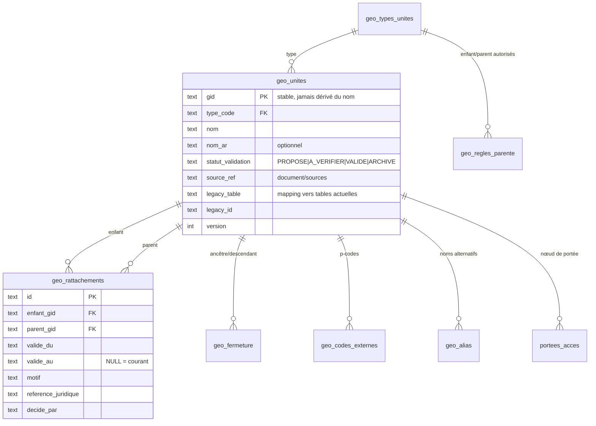
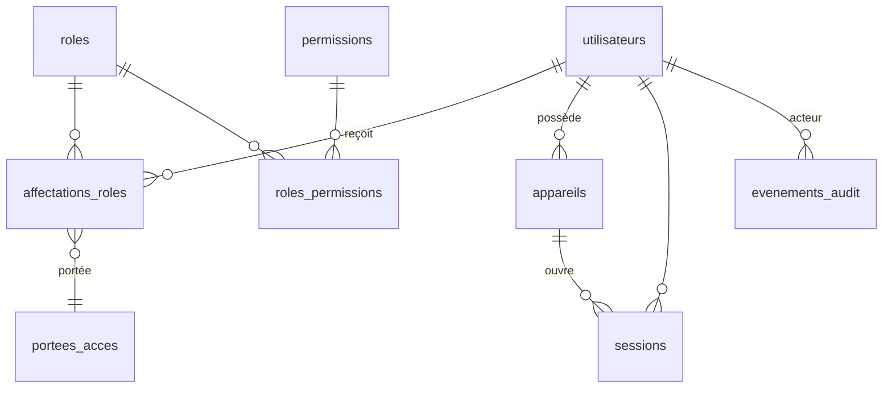
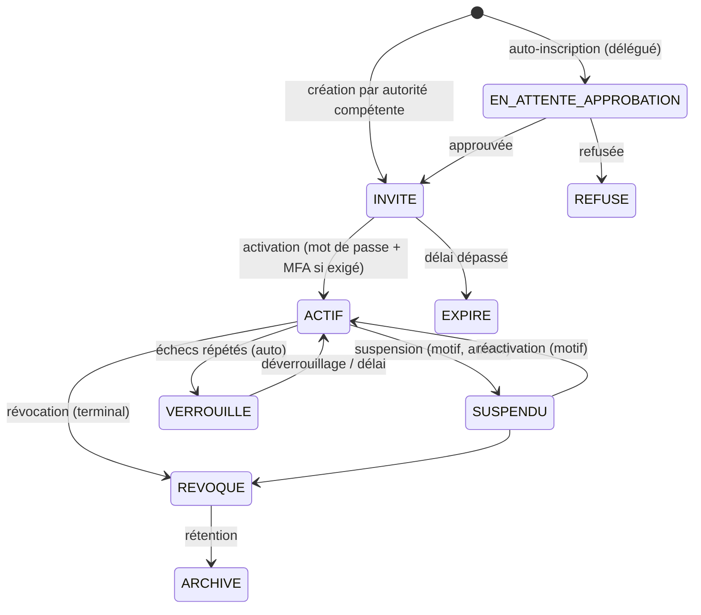
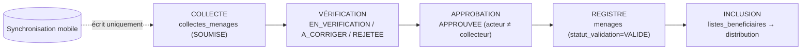

# 03 — Phase 1 : Architecture cible

> Statut : **proposition soumise à revue** — rien de ce document n'est implémenté. Les décisions ouvertes sont dans `05-decisions-a-valider.md` (références **D-xx**).
> Principe directeur : *strangler pattern* — on construit les nouvelles fondations **à côté** de l'existant (migrations additives, nouvelles routes `/api/v1`), on bascule module par module derrière des drapeaux, puis on retire l'hérité (Phase 5). Aucune réécriture globale.

## 0. Contraintes de plateforme et principes

| Contrainte | Conséquence de conception |
|---|---|
| Cloudflare D1 : pas de `PRAGMA foreign_keys=OFF` effectif, transactions = `db.batch()`, ~100 paramètres liés par requête | Migrations **additives** (expand/contract) ; plus de reconstruction de tables à grande échelle (cf. 0028/0035) ; filtres de portée par **jointure/CTE** sur table de portée, jamais par liste d'identifiants liés |
| Workers : pas de processus longs, CPU limité | Fermeture transitive précalculée (table), pas de récursion par requête ; synchronisation par lots bornés |
| Migrations immuables | Toute correction = nouvelle migration ; test « tout appliquer sur SQLite mémoire » (déjà en place via `tools/`) obligatoire en CI |
| Dépendances minimales (constat `02` classe E) | Aucune nouvelle dépendance runtime : OpenAPI généré depuis Zod (`z.toJSONSchema`), i18n maison, ULID/UUID via `crypto.randomUUID` |
| Français prioritaire, arabe/RTL possible | Clés typées `fr.ts` (source) / `ar.ts` (optionnel), `dir` dynamique, propriétés CSS logiques |
| Séparation **collecte → vérification → approbation → inclusion** | Quatre états/objets distincts, aucun raccourci par la synchronisation |
| Moindre privilège, refus par défaut | Chaque route déclare sa politique ; une route sans politique **fait échouer** la suite de tests |

### 0.1 Organisation cible du code (introduite progressivement, sans déplacement massif)

```
backend/src/
  core/            # transverses : authz (permissions, portée), audit, idempotence, erreurs, requestId, drapeaux
  modules/
    identite/      # comptes, rôles, sessions, appareils
    geo/           # référentiel, rattachements, portées, deltas
    beneficiaires/ # collecte, vérification, approbation, doublons
    sync/          # protocole mobile (push/pull, conflits, pièces)
    plateforme/    # console propriétaire (santé, drapeaux, paramètres)
    ...            # modules existants migrés un à un (stocks, distributions, rapports…)
  routes/          # héritées, retirées au fil des lots
frontend/src/
  consoles/{plateforme,national,provincial}/   # coques, navigation, pages de chaque console
  partage/         # composants communs (carte, tables, filtres, sélecteur géo) — issus de components/ui
  i18n/{fr.ts,ar.ts}
shared/            # contrats Zod + types + catalogue de permissions (source unique)
```

---

## 1. Architecture géographique

### 1.1 Point de départ (faits vérifiés — `evidence/inventaire-geo.json`)
* 23 provinces ; N'Djaména est la seule à `statut_particulier=1`.
* 112 départements : **80 `VALIDE` / 32 `A_VERIFIER`** (validation administrative et de rattachement) ; coordonnées **non renseignées pour les 112**.
* `sous_prefectures`, `cantons`, `communes` : **0 ligne** après migrations (500 communes de la Loi 015 supprimées par 0035 ; sources CSV conservées) ; 1 localité (ville) ; 0 site humanitaire ; 0 entrepôt.
* `province_id` est déjà une clé de partition **dénormalisée sur 34 tables** (ménages, stocks, distributions, audit…) → base saine pour l'isolation par province.
* Sources documentaires présentes : INSEED (départements de Sila), OCHA COD-AB ADM1 (GeoJSON + appariement), Loi 015/2024 (communes).

### 1.2 Ce que la cible **ne fait pas**
Elle n'invente aucune division. Les types de niveaux et leurs règles de parenté sont **configurables** et chargés depuis des sources identifiées ; tout niveau sans référence fiable reste `PROPOSE`/`A_VERIFIER` et **non utilisable pour une distribution** (règle existante conservée).

### 1.3 Modèle cible (additif, coexiste avec les tables actuelles)



* **`geo_unites.gid`** : pour les unités existantes, **le `id` actuel est conservé comme `gid`** (aucune réécriture de clés étrangères) ; pour les nouvelles, `crypto.randomUUID()` — jamais un slug de nom (un renommage ne change pas l'identité).
* **`geo_types_unites`** + **`geo_regles_parente`** : catalogue (province, département, sous-préfecture, commune, canton, arrondissement, quartier, carré, localité[ville|village|hameau|ferrick|campement], site humanitaire[catégories existantes], zone d'intervention) avec les couples parent→enfant autorisés. Les triggers actuels de cohérence territoriale (33 recréés par la migration 0028, 36 par la 0035) sont remplacés **un par un** par un contrôle unique au moment d'écrire un rattachement.
* **`geo_rattachements`** : *une ligne par période de validité*. Changer le rattachement = fermer la ligne (`valide_au`) + en ouvrir une autre, dans un même `batch()` ; **jamais** d'`UPDATE` du parent. L'historique est donc complet et les rapports « à la date D » utilisent les lignes valides à D.
* **`geo_fermeture`** (ancêtre, descendant, profondeur) pour l'**état courant** ; reconstruisible intégralement depuis `geo_rattachements` (script de vérification dans le même lot).
* **`geo_codes_externes`** (système `OCHA_PCODE`, `INSEED`, `LOI_015`, …) : donne les identifiants stables **externes** ; l'appariement OCHA ADM1 déjà produit sert à les renseigner pour les 23 provinces.
* **`geo_alias`** : noms alternatifs, graphies arabes, anciennes appellations.
* **Fusions/scissions** : `correspondances_fusions_territoriales` (existante) est conservée et reliée à `geo_unites` ; une unité fusionnée passe `ARCHIVE` avec renvoi vers la successeure — jamais supprimée.

### 1.4 Isolation et portées d'accès
* **`portees_acces`** (compte, nœud `gid`, `inclut_descendants`, `valide_du/au`, `accorde_par`, `statut`) : un compte reçoit **une ou plusieurs portées** (province, département, site…). Remplace `utilisateurs.province_id` + `perimetres_provinciaux_consultation` (migration par rétro-remplissage ; les colonnes restent jusqu'à Phase 5).
* **Prédicat de portée unique** : `appliquerPortee(requete, portee, colonneGeo)` produit une jointure `INNER JOIN geo_fermeture f ON f.descendant = <col> AND f.ancetre IN (SELECT gid FROM portees_actives WHERE compte_id = ?)`. Tout accès à une table opérationnelle passe par cet assistant ou par `province_id` (partition grossière conservée).
* **Garde-fous testables** : (1) test généré depuis la matrice des routes : pour chaque route de liste/détail, un compte hors portée reçoit 403/404 et **zéro ligne** ; (2) analyse statique légère : un test échoue si une requête SQL sur une table à `province_id` n'utilise pas l'assistant (liste blanche explicite) ; (3) l'inspection de chemin/corps de `isolationProvinciale` est supprimée au profit de la portée dérivée de la **ressource**, pas de la forme de la requête.
* **Isolation entre provinces** : portée province ⇒ aucune donnée d'une autre province, y compris dans les agrégats (les rapports nationaux n'utilisent que les rôles nationaux).

### 1.5 Rapports agrégés multi-niveaux
Agrégation via `geo_fermeture` (somme des descendants d'un niveau) ; vues de lecture `v_*` ou tables d'agrégats journaliers (`agregats_geo_jour`) recalculables — optionnelles, ajoutées seulement si les requêtes de `rapports.service.ts` dépassent le budget CPU mesuré. Les définitions de rapports restent celles de `rapports.service.ts` (aucun changement de règle métier).

### 1.6 Sélection en cascade
`GET /api/v1/geo/unites/{gid}/enfants?type=…` (pagination, filtre `statut_validation=VALIDE` par défaut, recherche accent-insensible) ; le `SelecteurLocalisationDynamique` (59 Ko) devient un composant mince au-dessus de cet endpoint. Les niveaux **facultatifs** (arrondissement, carré, canton) sont décrits par `geo_regles_parente`, pas codés en dur.

### 1.7 Synchronisation de référentiel
Compteur monotone `geo_version` (table `geo_journal_versions`) : chaque création/archivage/rattachement incrémente et journalise ; `GET /api/v1/mobile/referentiels/geo?depuis=<version>` renvoie les deltas (ajouts, mises à jour, fermetures, archivages — **jamais de suppression**) + `version_courante`. Un appareil conserve la version et rejoue les deltas.

### 1.8 Référence administrative fiable requise (ne rien inventer)
| Besoin | État | Source à obtenir |
|---|---|---|
| Liste officielle des **sous-préfectures** (par département) | vide | Texte officiel/INSEED à identifier (D-03) |
| **Communes** (Loi 015/2024) | supprimées du référentiel opérationnel par 0035, CSV disponibles | Décision : réintégrer comme niveau optionnel validé ? (D-03) |
| **Cantons**, découpage des arrondissements/quartiers hors N'Djaména | vide | Référence officielle (D-03) |
| 32 départements `A_VERIFIER` | `validation_administrative=A_VERIFIER` | Vérification INSEED (le doc `INVENTAIRE_DEPARTEMENTS_VERIFIES_SIGAD.md` couvre Sila) |
| Coordonnées des 112 départements | `NON_RENSEIGNE` | Jeu officiel (OCHA ADM2 si autorisé) |
| Sites humanitaires, entrepôts | vides | Saisie opérationnelle validée (HCR/OCHA/MASSNAH selon site) |

---

## 2. Identité, comptes et RBAC

### 2.1 Modèle cible



* **`permissions`** : catalogue **dans `shared/`** (source unique pour backend et frontend) sous la forme `ressource:action` (ex. `menages:lire_pii`, `collectes:approuver`, `stocks:receptionner`, `comptes:suspendre`, `plateforme:drapeaux:ecrire`), avec attributs `sensible`, `delegable`, `console` (plateforme|national|provincial), `necessite_portee`.
* **`roles`** : rôles **système** (code immuable) et **personnalisés** (créés dans des limites ; §2.4).
* **`affectations_roles`** : (compte, rôle, portée, validité, accordé par, statut). Remplace le `CASE` à trois tables de `auth.middleware.ts` ; pendant la transition, **mode ombre** : le rôle effectif est calculé par les deux méthodes, toute divergence est journalisée et le comportement reste celui de l'ancienne méthode (bascule par drapeau quand 0 divergence sur la suite complète).
* La table `utilisateurs` (identifiant, mot de passe, MFA, statut) et `sessions` sont **conservées** et étendues.

### 2.2 Séparation des responsabilités (rôles système cibles)

| Console | Rôle (code actuel conservé) | Portée | Principaux droits | Interdits structurels |
|---|---|---|---|---|
| Plateforme | `PROPRIETAIRE` | Plateforme | comptes racine, rôles/permissions, drapeaux, paramètres, santé, sessions/appareils, audit, opérations sensibles à double validation | **Aucune** lecture de données bénéficiaires nominatives ni action de distribution/stock (corrige F-04) ; accès agrégé non nominatif uniquement |
| National | `ADMIN_CENTRAL` | Nationale | opérations centrales, approbations centrales, validation des ménages (étape finale), rapports nationaux, comptes **territoriaux** (délégués, terrain) dans la limite de son plafond | gestion des rôles/permissions/drapeaux plateforme |
| Provincial | `DELEGUE_PROVINCIAL` | Province(s) | collecte/revue/vérification, opérations provinciales, listes, distributions, comptes terrain de sa province | tout hors portée |
| Provincial (terrain) | `SUPERVISEUR_TERRAIN` | Province/départements | vérification terrain, arbitrage des doublons (proposition) | approbation finale |
| Provincial (terrain) | `RESPONSABLE_STOCK` | Entrepôt(s) | réceptions, inventaire, sorties | émargement (incompatibilité de fonctions) |
| Provincial (terrain) | `AGENT_DISTRIBUTION` | Site(s) | émargement/remise | stocks |
| Transverse | `CONSULTATION_INSTITUTIONNELLE` | Nationale/multi-provinces | lecture agrégée non sensible | toute écriture |
| **Proposé** | `COLLECTEUR_TERRAIN` | Département(s)/zone | créer des **collectes** (Android/web), pas de vérification | vérifier/approuver ses propres collectes |

`COLLECTEUR_TERRAIN` est une **proposition** issue de F-03/F-11 : la documentation attribue la collecte à `SUPERVISEUR_TERRAIN`, qui est aussi vérificateur ; séparer collecte et vérification est nécessaire à la chaîne d'approbation (D-05). D'autres rôles ne sont créés que si l'analyse les prouve.

### 2.3 Cycle de vie des comptes



Toute transition : permission dédiée, `motif` obligatoire pour suspension/révocation, événement d'audit, **révocation immédiate des sessions et des appareils** si l'état n'est plus `ACTIF`. Les statuts actuels (`utilisateurs.statut`, `comptes_consultation.statut`, `inscriptions_delegues.statut`, `profils_operationnels_terrain.statut`) sont **projetés** dans cette machine d'états ; les colonnes existantes restent jusqu'à la bascule.

### 2.4 Rôles personnalisés — limites contrôlées
Un rôle personnalisé est une liste de permissions **non sensibles** et **délégables**. Invariants (chacun a un test) :
* **I1** nul ne peut accorder une permission qu'il ne détient pas ; **I2** ni une portée hors de la sienne ;
* **I3** nul ne modifie ses propres rôle, portée ou statut ;
* **I4** séparation des fonctions : l'auteur d'un acte ne peut pas l'approuver (paires configurables : collecte/approbation, réception/émargement) ;
* **I5** le dernier `PROPRIETAIRE` actif ne peut être ni suspendu, ni révoqué, ni rétrogradé ;
* **I6** un rôle personnalisé ne peut contenir `comptes:*`, `plateforme:*`, `audit:*`, `*:purger` ;
* **I7** réduire une portée ou retirer un rôle révoque les sessions concernées avant la fin de la requête.
Création de rôles personnalisés : réservée à `PROPRIETAIRE` ; avec `ADMIN_CENTRAL`, uniquement pour des rôles dont la portée ⊆ nationale et sans permission sensible (D-06).

### 2.5 Sessions, appareils, jetons
* Web : cookie de session + CSRF (**inchangé**), session liée au compte, expiration 8 h (constante actuelle).
* **`appareils`** (compte, plateforme, nom, empreinte de clé, statut `EN_ATTENTE|AUTORISE|REVOQUE`, autorisé par, dernière activité). Enregistrement par l'utilisateur, **autorisation par une autorité** de sa portée ; révocation immédiate.
* Mobile : jetons **opaques** hachés en D1 (même technique que les sessions web) : accès court (≈15 min) + rafraîchissement à **rotation avec détection de réutilisation** (réutilisation ⇒ révocation de la famille et de l'appareil). Pas de JWT, pas de nouvelle dépendance ; la révocation reste instantanée (vérification D1 à chaque requête, comme aujourd'hui).
* MFA : maintenu pour `PROPRIETAIRE`, `ADMIN_CENTRAL`, `CONSULTATION_INSTITUTIONNELLE` ; politique pour les rôles terrain mobiles = appareil autorisé + code PIN local (D-07).

### 2.6 Journal d'audit unifié
`evenements_audit` **append-only** : `id` (horodaté), `acteur_id`, `acteur_role`, `portee_gid`, `appareil_id`, `action` (catalogue), `cible_type/id`, `avant`/`apres` (JSON expurgé des secrets/PII), `motif`, `ip`, `request_id`, `resultat`. Triggers `BEFORE UPDATE/DELETE → RAISE(ABORT)` ; chaîne d'empreintes optionnelle (`empreinte_precedente`) pour détecter l'altération. Les journaux spécialisés existants restent écrits (compatibilité) et sont **alimentés aussi** vers `evenements_audit` via un adaptateur ; ils sont retirés en Phase 5 seulement après équivalence démontrée. **Actions sensibles** (motif obligatoire, double validation `maker-checker` pour les critiques) : purge de données de test, récupération propriétaire, attribution de permission sensible, fusion territoriale, activation de drapeau en production, révocation massive d'appareils, export de données nominatives.

### 2.7 Application côté backend (indépendante de l'interface)
* `exigerPermission("code", { portee: depuisRessource(...) })` — middleware **déclaratif** ; chaque route enregistre sa politique dans un registre unique (`core/authz/registre.ts`).
* La matrice de sécurité (générateur Phase 9 existant) est **dérivée du registre** ; le test `--check` échoue pour toute route sans politique (refus par défaut) et pour toute différence rôle×route non revue.
* Le frontend reçoit `permissions[]` et `portees[]` dans `GET /api/auth/session` **à titre d'affichage seulement** ; aucune décision de sécurité côté client.

---

## 3. Trois expériences administratives

### 3.1 Structure commune
Trois **coques** (`consoles/plateforme`, `consoles/national`, `consoles/provincial`), chacune avec sa table de routes, sa navigation déclarative (`{id, libelle_fr, libelle_ar?, icone, permission, route}` filtrée par **permission**, pas par rôle), sa page d'accueil et sa densité. Chargement paresseux **par console** (chunks séparés). Atomes partagés : `components/ui` (design system existant), carte SVG des provinces, tableaux/filtres, sélecteur géographique, composants de rapport. Préfixes d'URL `/plateforme/*`, `/national/*`, `/provincial/*` (les URL actuelles redirigent) et d'API `/api/v1/{plateforme|national|provincial}/*` (anciennes routes conservées en alias jusqu'à Phase 5).

### 3.2 A. Console Plateforme (propriétaire)
| Module | Contenu | Données/Back |
|---|---|---|
| Institutions & comptes | institutions (organisations), comptes, états, invitations, MFA | `organisations` (nouvelle ; décision D-08 : l'existant `comptes_consultation.institution` est du texte libre) |
| Rôles & permissions | catalogue lecture seule, rôles personnalisés, affectations, simulateur « que peut faire X ? » | `roles`, `permissions`, `affectations_roles` |
| Modules & drapeaux | activation par module/portée/environnement, historique, dépendances | `drapeaux_fonctionnalites` (support : `parametres_systeme` réutilisée, F-13) ; **évalués côté serveur**, jamais déduits de l'UI |
| Paramètres globaux | durées de session, politiques MFA, seuils | `parametres_systeme` |
| Santé & état | version de schéma/migration, ping D1/R2, taux d'erreur applicatif, files de pièces/sync | `GET /api/v1/plateforme/sante` (compteurs internes, pas de PII) |
| Sessions & appareils | liste, filtres, révocation unitaire/massive (double validation) | `sessions`, `appareils` |
| Audit & opérations sensibles | explorateur filtré, export, file maker-checker | `evenements_audit` |
**Garde-fous** : aucune permission `menages:*`, `distributions:*`, `stocks:*` n'est attribuable à la console plateforme ; les compteurs affichés sont agrégés. Les opérations dangereuses (purge, récupération, drapeau en production, révocation massive) exigent motif + second approbateur + délai de rétractation quand c'est possible.

### 3.3 B. Console Administration centrale (nationale)
Accueil « **Situation nationale** » et non « liste de ménages » : carte interactive (composant existant `CarteProvincesTchad`, contrat KPI `UI_MAP_1_3_KPI_CONTRACT.md`), indicateurs bénéficiaires/distributions/stocks, avancement des opérations, alertes (retards de validation, rupture/péremption, écarts). Sections : *Opérations & approbations* (opérations centrales existantes), *Validation & arbitrage* (file nationale des ménages à valider, doublons escaladés), *Performance des délégations* (**nouveau** : délais de validation, taux de rejet, couverture de distribution, stocks vs besoins, activité de collecte, comparaison inter-provinciale), *Stocks & approvisionnements nationaux*, *Rapports agrégés* (existants), *Comptes territoriaux*. Principe : **agrégé d'abord, exploration en descente (province → département)**, jamais l'édition en masse des enregistrements provinciaux.

### 3.4 C. Console Délégation provinciale
En-tête permanent « **Périmètre** » (province, départements couverts, version du référentiel). Sections : *Collecte & revue* (file : à vérifier, à corriger, doublons, conflits de synchronisation), *Bénéficiaires* de la province (PII masquée par défaut, dévoilement tracé), *Opérations provinciales* et *Distributions*, *Stocks & entrepôts*, *Tâches & demandes* (boîte unique : validations, corrections, approbations en attente), *Indicateurs locaux* et rapports, *Activité terrain* (fil des synchronisations, appareils actifs, anomalies).

### 3.5 Langue et RTL
`i18n/fr.ts` fait foi ; `i18n/ar.ts` incrémental ; `html[dir]` basculé par la langue ; nouveaux composants en propriétés logiques (`margin-inline-*`) ; chaînes serveur renvoyées sous forme de **codes d'erreur** + message FR (la traduction se fait côté client). Aucune migration forcée de l'existant : module par module (Batch 3.5).

---

## 4. Enregistrement des bénéficiaires et synchronisation Android

### 4.1 Chaîne d'états séparés



**Invariant fondamental** : le canal de synchronisation n'a **aucune permission** sur `menages`, `listes_beneficiaires`, `inscriptions_beneficiaires` ni `distributions_*` ; un trigger refuse toute insertion dans `menages` sans `approbation_collecte_id` valide (défense en profondeur) pour les nouveaux flux. `menages` reste le **registre des bénéficiaires approuvés**, ses triggers d'immuabilité (ménage figé dans une distribution) restent inchangés.

### 4.2 Modèle de données (additif)
* **`collectes_menages`** : `id` (serveur), `appareil_id` + `client_local_id` (UNIQUE ensemble), `collecteur_id`, `geo_gid`, `province_id`, `statut_collecte`, `version`, `schema_version`, `donnees_json` (validé par Zod `vN`), `source` (`ANDROID|WEB|IMPORT`), `capture_le` (horloge appareil), `recu_le` (serveur), `version_app`, `menage_id` (renseigné à l'approbation).
* **`collectes_membres`**, **`collectes_pieces`** (type, taille, `sha256`, statut `EN_ATTENTE|VERIFIEE|REJETEE`, objet R2).
* **`ops_sync`** (idempotence mobile) : UNIQUE (`appareil_id`, `op_id`), résultat mémorisé, `sequence_appareil`, `lot_id`.
* **`conflits_sync`** : entité, `version_serveur`, charge client, champs divergents, statut `OUVERT|RESOLU`, résolution et auteur.
* **`decisions_doublons`** (extension de `signalements_doublons` avec `collecte_id`) ; l'existant (aucune fusion automatique) est conservé.
* **`provenance`** : `menages.collecte_id`, `menages.source`, historique via `evenements_audit` et `historique_statuts`.

### 4.3 Doublons
À la soumission : calcul de candidats **côté serveur** (téléphone normalisé, nom normalisé + phonétique + géographie, année de naissance des membres). Résultat : liste de candidats attachée à la collecte, jamais de fusion automatique. Décisions du vérificateur : `DISTINCT`, `MISE_A_JOUR_DE(menage_id)` (propose un changement sans écraser), `DOUBLON_REJETE`. Fusion de fiches existantes : action centrale tracée, réversible logiquement (liens conservés).

### 4.4 Protocole de synchronisation (REST, versionné `/api/v1/mobile`)
| Endpoint | Rôle |
|---|---|
| `POST /appareils/enregistrement` | demande d'autorisation d'appareil |
| `POST /auth/jeton` · `/auth/rafraichir` · `/auth/revoquer` | émission/rotation/révocation de jetons |
| `GET /referentiels/{geo\|nomenclatures\|schemas}?depuis=` | deltas de référentiels |
| `POST /sync/push` | lot d'opérations `{op_id, type, client_local_id, base_version, capture_le, charge}` → résultat **par opération** `{op_id, statut: ACCEPTE\|DEJA_TRAITE\|CONFLIT\|REJETE, serveur_id, version, erreurs[{code, champ, message}]}` |
| `GET /sync/pull?curseur=` | changements concernant **les collectes de l'appareil** (statuts, corrections demandées, conflits) |
| `POST /pieces/intentions` puis `PUT /pieces/{id}` | pièces jointes |
* **Idempotence** : (`appareil_id`, `op_id`) unique ; rejouer renvoie le résultat mémorisé (jamais de double création). Hachage de la charge : même `op_id` avec contenu différent ⇒ 409.
* **Opérations tardives** : acceptées avec leur `capture_le` ; tolérance d'horloge bornée ; l'ordre d'application suit `sequence_appareil` par `client_local_id`.
* **Conflits** : concurrence optimiste par `base_version` ; en cas d'écart sur une collecte déjà vérifiée/approuvée ⇒ `CONFLIT` + enregistrement dans `conflits_sync` (les deux versions conservées), arbitrage par le vérificateur ; **jamais d'écrasement silencieux**.
* **Pièces jointes** : déclaration préalable (type, taille, `sha256`), envoi via le Worker (liaison R2), contrôle d'en-têtes/MIME (`fichiers-securite.service.ts` existant), plafond de taille, statut `EN_ATTENTE` tant que non vérifiée, stockage sous `collectes/{province}/{collecte}/{piece}`, téléchargement uniquement par API avec contrôle de portée (aucun lien public).
* **Autorisation d'appareil** : appareil `REVOQUE` ⇒ 403 + indicateur `effacement_requis` ; opérations capturées avant l'heure de révocation mises en **quarantaine** (visibles du vérificateur, non appliquées) — règle exacte à valider (D-07).
* **Données sensibles** : permission `menages:lire_pii` distincte ; listes masquées par défaut ; le client n'obtient **que ses propres collectes** (pas de téléchargement du registre) ; spécification Android : stockage chiffré (SQLCipher/Keystore), purge à la révocation.

### 4.5 Contrat d'API
* Versionnement par URL `/api/v1` ; évolutions **additives** uniquement ; retrait par en-tête `Deprecation`/`Sunset` ; `X-Client-Version` + version minimale (`426 Upgrade Required`).
* Erreurs : `{ code, message, details[], request_id }` (codes stables, messages FR) — l'actuel `{ erreur: string }` reste servi sur les routes héritées.
* **OpenAPI 3.1 généré** depuis les schémas Zod de `shared/` (`z.toJSONSchema`) vers `docs/api/openapi-v1.json`, avec **tests de contrat** (la réponse réelle valide le schéma) ; documents et exemples de requêtes de lot pour l'équipe Android.

### 4.6 Cohabitation avec le web existant
`POST /api/gestion/menages` et l'import CSV/XLSX continuent de fonctionner (idempotence comprise). Dans un second temps (Batch 4.8, derrière le drapeau `collecte_unifiee`), ils appellent le même service de domaine « collecte → approbation » pour supprimer le double chemin ; **jusque-là, ils ne sont pas modifiés**.

---

## 5. Qualité, sécurité, maintenabilité

* **Pyramide cible** : unitaires (domaine pur : portée, permissions, idempotence, résolution de conflit) ; intégration Wrangler (existante) ; **tests générés** rôle×route, portée×route, invariants I1–I7 ; tests de migration (application complète sur mémoire + rejeu depuis un instantané représentatif) ; tests de contrat OpenAPI ; e2e Playwright par console ; tests RTL par captures.
* **Migrations** : une migration = un objectif, additive (expand), jamais d'`UPDATE` de données sans script de vérification (comptes avant/après) ; contract (retrait) uniquement en Phase 5 ; chaque migration livre son script `down` *documenté* (restauration depuis sauvegarde/export, car SQLite/D1 ne permet pas un `DROP COLUMN` sûr dans tous les cas) ; essai sur copie locale **avant** tout environnement distant ; aucune application sur staging/production sans autorisation explicite.
* **Sécurité** : refus par défaut (registre de politiques), audit unifié, jetons mobiles à rotation, limitation de débit par appareil/compte (en plus des règles Cloudflare), expurgation de PII dans les journaux, en-têtes existants conservés.
* **Observabilité** : `request_id` propagé (réponse, audit, logs) ; compteurs internes exposés par la console plateforme.
