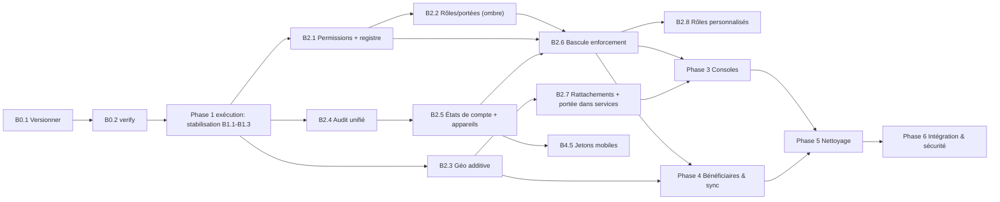

# 04 — Feuille de route par lots

> Chaque **lot** (Batch) est exécutable seul, dans une session courte, avec : périmètre, fichiers/composants touchés, critères d'acceptation, tests obligatoires, risques et retour arrière.
> Aucun lot n'est exécuté à ce stade. **Phase 2 et suivantes ne démarrent qu'après revue de ce dossier** (`05-decisions-a-valider.md`).

## 0. Règles d'exécution communes (Définition de « terminé »)

1. **Avant** de commencer : `npm run verify` (créé en B0.2) vert ; état noté dans `00-journal-decisions-et-progres.md`.
2. **Un lot = une branche locale + un commit (ou une courte série)** ; message `feat|fix|refactor|test(<lot>): …` ; **jamais de push** sans autorisation.
3. **Migrations** : fichier additif numéroté (≥ 0036), appliqué d'abord sur SQLite en mémoire (`tools/inventaire-schema-memoire.mjs`) et sur la D1 **locale temporaire** des tests ; jamais sur staging/production sans autorisation écrite.
4. **Comportement** : les tests existants (151 unitaires, 18 intégration, matrice 216 routes) restent verts ; toute modification de matrice est revue ligne à ligne.
5. **Drapeaux** : tout comportement nouveau visible est derrière un drapeau désactivé par défaut tant que le lot suivant n'a pas validé la bascule.
6. **Clôture** : mettre à jour le journal (décisions, preuves, commande + résultat), la matrice de sécurité régénérée, et la section « Reprise » du README.
7. **Retour arrière** par défaut : `git revert` du commit du lot ; pour une migration appliquée localement : recréer la base (reset local) ; pour un environnement distant : **restauration depuis la sauvegarde pré-migration** (outil archivé en classe D de `02`), jamais de `DROP` improvisé.

## 1. Ordre, dépendances et écarts par rapport à l'ordre imposé

**Écarts documentés (et pourquoi)** :
* **B0.1/B0.2 et lots 1.x insérés avant la Phase 2** : le travail non versionné (F-01) et les défauts confirmés F-02/F-03 rendent toute refonte non réversible ou non vérifiable. Les lots 1.x produisent l'« oracle » de non-régression.
* **Audit unifié (B2.4) et appareils (B2.5) dans la Phase 2** et non en Phase 4 : ils conditionnent la bascule RBAC (B2.6) et les consoles.
* **Phase 5 partiellement entrelacée** : un nettoyage n'a lieu qu'avec le lot qui rend l'élément inutile (règle de `02` §4) ; seuls 5.1/5.4/5.5 (faible risque) sont indépendants.
* **Phase 4 peut démarrer en parallèle de la Phase 3** après B2.6, car les deux ne partagent que le catalogue de permissions.

---

## Phase 0 — Fondations de reprise

### B0.1 — Versionner l'existant (prérequis absolu)
* **Périmètre** : commits locaux de point de référence sur une branche `baseline/2026-10-26-etat-actuel` en séparant : (a) migrations 0022–0035 + `wrangler.*.toml` ; (b) backend/shared ; (c) frontend ; (d) tests ; (e) `sources/` ; (f) documentation (captures en dernier, option Git LFS ou exclusion — D-09).
* **Fichiers** : tous les non suivis/modifiés (302 + 67) ; `.gitignore` inchangé (déjà protecteur : `private/`, `.env*`, `*.sqlite`, `codes-activation*.json`).
* **Acceptation** : `git status` propre ; `git ls-files migrations | wc -l` = 35 ; un clone frais de la branche passe `npm ci && npm run verify`.
* **Tests** : ceux du baseline (`evidence/`).
* **Risques** : commit accidentel de secrets → contrôle préalable `git diff --cached` + recherche de motifs (`eyJ`, `-----BEGIN`, `RESEND_API_KEY=`) ; volumétrie (28 Mo de docs).
* **Retour arrière** : `git reset --hard` sur le tag de départ n'est pas nécessaire (aucun fichier modifié) ; supprimer la branche.

### B0.2 — Pipeline de vérification unique `npm run verify`
* **Périmètre** : script chaînant `tsc --noEmit` (non mutant — remplace l'usage de `wrangler types` dans le contrôle), `vitest`, `--check` de la matrice, application des migrations en mémoire (`tools/`), intégration Wrangler ; option `--rapide` (sans intégration) ; `wrangler.toml.example` pour retirer l'identifiant de production du suivi (D-10).
* **Fichiers** : `package.json`, `scripts/verify.mjs`, `wrangler.toml.example`, README.
* **Acceptation** : `verify` ≈ vert sur l'état courant ; rapport horodaté dans `docs/architecture-modernization/evidence/` ; temps total consigné.
* **Tests** : lui-même ; le baseline doit être reproduit à l'identique (151 / 17+1 / 216 / 35 migrations).
* **Risques** : durée (≈ 3,5 min) ; ne pas masquer l'échec d'un sous-script.
* **Retour arrière** : retirer le script.

---

## Phase 1 (exécution) — Stabilisation et filets de sécurité

### B1.1 — Tests de caractérisation des autorisations + examen du 500 observé
* **Périmètre** : générer depuis la matrice des routes un test **rôle × route** (7 rôles, 216 routes) qui **fige le comportement actuel** (y compris F-03 : rôles terrain bloqués) en mode « snapshot revu » ; examiner le `POST /api/stocks/receptions-stock → 500` du journal d'intégration (injection volontaire ou défaut ?).
* **Fichiers** : `tests/integration/caracterisation-roles.test.mjs`, `tests/integration/__snapshots__/`, `scripts/generer-matrice-securite-phase9.mjs` (lecture seule).
* **Acceptation** : le snapshot est déterministe (2 exécutions identiques) ; chaque écart avec `MATRICE_RESPONSABILITES…` est classé *bogue / intention non implémentée / doc obsolète* dans le journal.
* **Tests** : le nouveau test + matrice existante.
* **Risques** : snapshot trop volumineux → un fichier par rôle ; faux sentiment de validité (le snapshot décrit l'existant, pas le souhaitable).
* **Retour arrière** : supprimer les fichiers de test.

### B1.2 — Correction F-02 : refus d'un ménage (`REFUSE` vs `REJETE`)
* **Périmètre** : (1) test d'intégration **rouge** reproduisant `POST /api/gestion/menages/:id/validation {decision:"REFUSER"}` → 500 ; (2) décision D-01 (valeur canonique) ; (3) **migration 0036** additive (reconstruction ciblée de `menages` avec la CHECK corrigée **et** recréation des triggers concernés — copie des 5 triggers de statut de 0028/0022), avec script de comptage avant/après ; (4) alignement `gestion.routes.ts`, types, UI.
* **Fichiers** : `migrations/0036_*.sql`, `backend/src/routes/gestion.routes.ts` (L.92, 171, 1414), `shared/validations/beneficiaires.ts`, `frontend/.../TableauGestionBeneficiaires.tsx`, `tests/integration/auth-worker.test.mjs` (ou nouveau fichier).
* **Acceptation** : le test passe au vert ; tous les ménages existants conservent id/code/statut (comparaison avant/après) ; les triggers de 0028 sont toujours présents (`SELECT name FROM sqlite_master WHERE type='trigger'` identique, sauf corrections nommées).
* **Tests** : intégration complète + `inventaire-schema-memoire` (le test `REFUSE` doit passer ou la valeur canonique ajustée) + `db:verifier`.
* **Risques** : reconstruction d'une table centrale sous D1 (pas de `foreign_keys=OFF`) → alternative moins risquante à évaluer d'abord : **ne pas reconstruire** et écrire `REJETE` côté code en recréant uniquement les triggers (aucune reconstruction de table) — à trancher en D-01 avec essai sur copie ; données `REFUSE` éventuelles en staging.
* **Retour arrière** : restauration depuis export pré-migration ; en local, reset de base.

### B1.3 — Réconciliation de la logique d'approbation et correction documentaire
* **Périmètre** : comparer `operation-centrale.service.ts` (`changerStatutOperation`, `enregistrerApprobationOperation`, `obtenirDetailOperation`, `calculerConsolidationNationale`, jamais appelées) à `operations-centrales.routes.ts` ; déterminer laquelle fait foi ; documenter ; annoter les docs contredites (matrice des responsabilités, mode hors-ligne, « audit inaltérable ») avec un bandeau « Écart constaté — voir audit F-0x » **sans** les réécrire.
* **Fichiers** : lecture des deux fichiers ; docs ; éventuel test de caractérisation `tests/unit/operations-centrales.test.mjs` (existant) étendu.
* **Acceptation** : tableau « règle → implémentation → test » complet pour la chaîne d'approbation ; aucune modification du code métier.
* **Tests** : unitaires existants ; nouveaux tests seulement si une règle n'est pas couverte.
* **Risques** : découverte d'une règle d'approbation non appliquée ⇒ **escalade à l'utilisateur** (D-12) avant toute correction (consigne : ne pas modifier les règles sensibles sur des inférences).
* **Retour arrière** : `git revert`.

---

## Phase 2 — Fondations identité et géographie

### B2.1 — Catalogue de permissions et registre de politiques (sans changement de comportement)
* **Périmètre** : `shared/permissions/catalogue.ts` (codes, sensibilité, délégabilité, console) ; `backend/src/core/authz/registre.ts` : chaque route déclare `{permission, portee}` ; les politiques sont **dérivées du comportement actuel** (B1.1) ; `exigerPermission` écrit en **mode observation** (calcule, compare à l'ancienne décision, journalise l'écart, n'applique pas).
* **Fichiers** : `shared/permissions/*`, `backend/src/core/authz/*`, `backend/src/index.ts` (montage observateur), générateur de matrice.
* **Acceptation** : 216/216 routes ont une politique ; 0 écart entre décision observée et décision actuelle sur la suite complète ; une route sans politique fait échouer le test.
* **Tests** : nouveau test « registre complet » ; caractérisation B1.1 inchangée ; unitaires du moteur de décision (table de vérité).
* **Risques** : perf (un calcul de plus par requête) → budget mesuré ; dérive entre registre et routes.
* **Retour arrière** : drapeau `authz_observation=off` puis `git revert`.

### B2.2 — Rôles, affectations et portées (mode ombre)
* **Périmètre** : migration additive `roles`, `permissions`, `roles_permissions`, `affectations_roles`, `portees_acces` ; rétro-remplissage depuis `utilisateurs`, `profils_operationnels_terrain`, `comptes_consultation`, `perimetres_provinciaux_consultation` ; calcul du rôle effectif **en double** (ancien `CASE` / nouveau) dans `auth.middleware.ts` avec journalisation des divergences.
* **Fichiers** : `migrations/00NN_identite_roles_portees.sql`, `backend/src/core/authz/*`, `backend/src/middlewares/auth.middleware.ts`, test de rétro-remplissage.
* **Acceptation** : pour chaque compte du jeu de test et du seed, rôle/province effectifs identiques (0 divergence) ; comptage avant/après des lignes sources inchangé ; aucune colonne ancienne modifiée.
* **Tests** : intégration (auth, MFA, comptes, consultation, terrain) ; test de divergence ; migration sur mémoire.
* **Risques** : double lecture ralentit l'auth → mesurer ; erreurs de rétro-remplissage → script de comparaison obligatoire.
* **Retour arrière** : désactiver la lecture nouvelle (drapeau) ; tables additives laissées vides.

### B2.3 — Référentiel géographique additif et API de lecture
* **Périmètre** : migration `geo_types_unites`, `geo_regles_parente`, `geo_unites`, `geo_rattachements`, `geo_fermeture`, `geo_codes_externes`, `geo_alias`, `geo_journal_versions` ; rétro-remplissage depuis `provinces`, `departements`, `arrondissements`, `quartiers`, `carres`, `localites`, `sites_humanitaires`, `cantons`, `sous_prefectures` (**`gid` = id existant**) ; p-codes OCHA ADM1 depuis `matching-cod-ab-adm1-ui-map-1.csv` ; `GET /api/v1/geo/unites/{gid}/enfants`, `/ancetres`, `/recherche`.
* **Fichiers** : `migrations/`, `backend/src/modules/geo/*`, `shared/types/geo.ts`, tests.
* **Acceptation** : nombre d'unités par type = nombre de lignes sources (23 provinces, 112 départements, 10 arrondissements, 19 quartiers, …) ; fermeture reconstruite = fermeture stockée (test) ; aucune écriture dans les tables héritées ; 0 unité inventée (toute unité provient d'une ligne existante ou d'une source citée).
* **Tests** : unitaires (fermeture, règles de parenté) ; intégration (cascade) ; rétro-remplissage idempotent (2ᵉ exécution = 0 changement).
* **Risques** : désynchronisation avec les tables héritées pendant la transition → les écritures territoriales existantes appellent un **adaptateur de double écriture** (B2.7) ; communes : traité par D-03 (non réintégrées ici).
* **Retour arrière** : tables additives ignorées ; `git revert`.

### B2.4 — Journal d'audit unifié append-only
* **Périmètre** : `evenements_audit` + triggers anti-modification ; service `core/audit` ; adaptateurs : `journaux_audit`, `audits_territoire`, `historique_decoupages`, `decisions_comptes`, `historique_operations_centrales` alimentent aussi le journal unifié (sans retirer leurs écritures) ; `request_id` propagé.
* **Fichiers** : migration, `backend/src/core/audit/*`, `backend/src/middlewares/audit.middleware.ts`, points d'écriture existants (3 fichiers + services concernés).
* **Acceptation** : toute action sensible listée en `03` §2.6 produit **un** événement unifié (test par action) ; `UPDATE`/`DELETE` sur `evenements_audit` échouent ; aucun secret ni mot de passe ni PII non masquée dans `avant/apres` (test d'expurgation).
* **Tests** : intégration par action sensible ; test d'immuabilité ; test d'expurgation.
* **Risques** : surcoût d'écriture ; double écriture non atomique → même `db.batch()` que l'action.
* **Retour arrière** : désactiver l'adaptateur ; table laissée en place.

### B2.5 — États de compte, sessions et appareils (modèle + API d'administration)
* **Périmètre** : `appareils`, extension `sessions` (`appareil_id`, `type`, `motif_revocation`) ; machine d'états de compte (transitions + motifs + audit) ; révocation immédiate des sessions/appareils sur sortie de `ACTIF` ; API plateforme/centrale de gestion des appareils.
* **Fichiers** : migration, `backend/src/modules/identite/*`, `comptes.routes.ts` (extraction progressive), tests.
* **Acceptation** : tableau de transitions testé (autorisée/interdite par rôle) ; session invalide à la requête suivante après suspension ; invariant I5 (dernier propriétaire).
* **Tests** : intégration comptes (existants + nouveaux), unitaires de la machine d'états.
* **Risques** : régression des parcours d'inscription/activation → exécuter intégralement les tests `comptes-*`, `auth-*`, `recovery-*`.
* **Retour arrière** : drapeau `etats_compte_v2=off`.

### B2.6 — Bascule de l'application des permissions
* **Périmètre** : passage du mode observation à l'**application** de `exigerPermission`, **module par module** (ordre : comptes → territoire → rapports → gestion → stocks → approvisionnements → distributions → opérations centrales) ; décisions D-02 (propriétaire sans accès opérationnel) et D-04 (rôles terrain : comportement cible) appliquées **ici seulement**, après validation ; suppression des limiteurs en ligne remplacés.
* **Fichiers** : `backend/src/index.ts`, routes concernées, registre, matrice, tests.
* **Acceptation** : après chaque module, caractérisation B1.1 = snapshot **attendu** (écarts = uniquement ceux validés par D-02/D-04, listés) ; matrice `--check` verte ; aucun accès nouveau accordé sans décision écrite.
* **Tests** : caractérisation, intégration par module, e2e du module.
* **Risques** : verrouillage accidentel d'utilisateurs légitimes → bascule par drapeau **par module**, ordre croissant de criticité ; staging seulement après autorisation.
* **Retour arrière** : drapeau du module repassé en observation.

### B2.7 — Rattachements datés et portée dans les services
* **Périmètre** : écriture de rattachements (fermer/ouvrir), maintien de `geo_fermeture`, **adaptateur de double écriture** avec les tables héritées, `appliquerPortee` utilisé par les listes (ménages, stocks, distributions, rapports) ; suppression de `isolationProvinciale` basée sur le chemin au profit de la portée de ressource.
* **Fichiers** : `backend/src/modules/geo/*`, `territoire.*`, `administration-territoriale.*`, services de listes, `rbac.middleware.ts`.
* **Acceptation** : test d'isolation généré : pour chaque route de liste/détail, compte province A ⇒ 0 donnée province B ; changement de rattachement d'un département : l'historique est conservé et les rapports « à la date D » restent exacts (test) ; fermeture = recalcul complet.
* **Tests** : isolation, historique, intégration territoriale existante (100 % vert).
* **Risques** : régression des agrégats ; double écriture incohérente → comparaison automatique nocturne locale (script) avec rapport.
* **Retour arrière** : drapeau `geo_v2_ecriture=off`.

### B2.8 — Rôles personnalisés bornés
* **Périmètre** : API/UI de création de rôles personnalisés, invariants I1–I7.
* **Acceptation/Tests** : un test par invariant (tentatives d'escalade directes, indirectes, via rôle personnalisé, via portée) ; fuzz léger sur combinaisons rôle×permission.
* **Risques/Retour** : drapeau `roles_personnalises`.

---

## Phase 3 — Consoles administratives

### B3.1 — Coque multi-consoles et routage
* **Périmètre** : `consoles/{plateforme,national,provincial}` (coques + navigation déclarative par permission), chargement paresseux par console, redirection des URL actuelles ; aucune page métier réécrite : les composants existants sont montés tels quels dans la console adéquate.
* **Fichiers** : `frontend/src/App.tsx` (aiguillage), `frontend/src/consoles/*`, `navigation-config.ts`, `vite.config.ts`.
* **Acceptation** : chaque rôle atterrit dans sa console ; les anciennes URL fonctionnent (redirection) ; taille des chunks par console consignée ; `shadcn-admin-navigation.test.mjs` adapté/vert.
* **Tests** : unitaires de navigation (permission → entrées), e2e `top-navigation-compacte`, `global-admin-ui`.
* **Risques** : régressions de navigation (e2e existants). **Retour** : drapeau `consoles_v2` (ancienne coque conservée).

### B3.2 — Console Plateforme
* **Périmètre** : institutions/comptes, rôles & permissions (lecture + simulateur), drapeaux, paramètres, santé, sessions/appareils, audit, file de validation des opérations sensibles ; **retrait de l'UI** des modules opérationnels pour le propriétaire (la fermeture API est en B2.6).
* **Acceptation** : un parcours e2e par module ; aucune donnée nominative affichée ; chaque opération dangereuse exige motif + second approbateur (test).
* **Tests** : intégration des API `plateforme`, e2e, test « le propriétaire n'a accès à aucune route `menages:*` ».
* **Risques** : surface d'attaque élargie → tout derrière permissions `plateforme:*`. **Retour** : drapeau.

### B3.3 — Console Administration centrale
* **Périmètre** : accueil « Situation nationale », carte, indicateurs, avancement, **Performance des délégations** (nouveaux indicateurs calculés sur données existantes), validation/arbitrage, rapports, comptes territoriaux.
* **Acceptation** : contrats KPI (`ui-map-kpi-contract.test.mjs`) inchangés ; les nouveaux indicateurs ont une définition écrite et un test de calcul sur jeu synthétique ; aucune édition en masse de données provinciales.
* **Tests** : unitaires des indicateurs, intégration rapports, e2e carte. **Risques** : performances (CPU Worker) → budget mesuré en B6.4. **Retour** : drapeau.

### B3.4 — Console Délégation provinciale
* **Périmètre** : en-tête de périmètre, file de collecte/revue (branchée sur Phase 4 au fur et à mesure), bénéficiaires masqués par défaut, opérations, stocks, distributions, tâches/demandes, indicateurs, activité terrain.
* **Acceptation** : un délégué ne voit **que** sa portée (test d'isolation B2.7) ; PII masquée + dévoilement journalisé. **Tests** : e2e délégué, isolation. **Retour** : drapeau.

### B3.5 — i18n et RTL
* **Périmètre** : `i18n/fr.ts` (extraction progressive module par module, nouvelles consoles d'abord), `ar.ts` partiel, `dir` dynamique, propriétés logiques.
* **Acceptation** : aucune chaîne en dur dans les nouvelles consoles (test statique) ; captures RTL d'un écran par console. **Retour** : français seul (défaut).

---

## Phase 4 — Bénéficiaires et synchronisation Android

### B4.1 — Conventions API v1, OpenAPI généré, modèle d'erreurs
* **Périmètre** : `/api/v1`, enveloppe d'erreur `{code,message,details,request_id}`, `X-Client-Version`, génération OpenAPI 3.1 depuis Zod (`docs/api/openapi-v1.json`), tests de contrat.
* **Acceptation** : le document est reproductible (même sortie à chaque génération) ; chaque endpoint v1 a un test de contrat ; routes héritées inchangées. **Retour** : `git revert` (routes v1 additives).

### B4.2 — Service d'idempotence commun
* **Périmètre** : extraire `lireCleIdempotence` (5 copies), `validerCleIdempotence` (2 copies) et les deux moteurs (`stock.service`, `idempotence-import.service`) vers `core/idempotence` ; tests de **caractérisation avant extraction** (mêmes réponses pour mêmes entrées).
* **Acceptation** : tests d'idempotence existants verts sans modification ; format de clé stockée inchangé (compatibilité des clés en base). **Risques** : modification subtile du hachage/portée ⇒ test de rejeu sur clés pré-existantes. **Retour** : `git revert`.

### B4.3 — Tables de collecte et machine d'états
* **Périmètre** : `collectes_menages/membres/pieces`, `ops_sync`, `conflits_sync`, extension `signalements_doublons`, trigger `menages` ← `approbation_collecte_id` (nouveaux flux seulement) ; schémas Zod `schema_version=1`.
* **Acceptation** : matrice de transitions testée ; **la synchronisation ne peut pas écrire `menages`** (test direct SQL + API) ; ménages existants intacts (comptage). **Tests** : unitaires + intégration + migration mémoire. **Retour** : tables additives.

### B4.4 — Vérification, approbation, doublons
* **Périmètre** : services et routes : vérifier/renvoyer à corriger/rejeter/approuver ; création du ménage **uniquement** à l'approbation, acteur ≠ collecteur (I4) ; candidats de doublons ; décisions.
* **Acceptation** : un collecteur ne peut ni vérifier ni approuver sa collecte (test) ; aucun doublon fusionné automatiquement (test avec jeux proches) ; chaîne complète collecte → ménage `VALIDE` → inclusion en liste fonctionne via les mécanismes **existants**. **Tests** : intégration + régression `gestion` / `distributions`. **Retour** : drapeau `collecte_v1`.

### B4.5 — Appareils et jetons mobiles
* **Périmètre** : enregistrement/autorisation/révocation, jetons accès + rafraîchissement à rotation, détection de réutilisation, `effacement_requis`.
* **Acceptation** : réutilisation d'un jeton de rafraîchissement ⇒ famille révoquée ; appareil révoqué ⇒ 403 immédiat ; permissions appliquées via le registre. **Tests** : intégration, sécurité (rejeu, expiration, appareil d'un autre compte). **Retour** : drapeau `mobile_v1`.

### B4.6 — Synchronisation : push/pull, idempotence, conflits, opérations tardives
* **Périmètre** : `POST /sync/push` par lot (résultats par opération), `GET /sync/pull`, deltas de référentiels (géo, nomenclatures, schémas), détection de conflits par `base_version`.
* **Acceptation** : rejouer 2× le même lot ⇒ aucun doublon, mêmes résultats ; opération tardive (capture ancienne) acceptée avec sa date ; conflit sur collecte vérifiée ⇒ `CONFLIT` + deux versions conservées ; lot partiellement invalide ⇒ succès partiel détaillé ; ordre inversé des opérations ⇒ résultat identique. **Tests** : intégration + simulateur d'appareil Node (`tests/integration/sync-simulateur.mjs`) avec coupures, doubles envois, horloge décalée. **Retour** : drapeau.

### B4.7 — Pièces jointes sécurisées
* **Périmètre** : intention + envoi, contrôle taille/MIME/`sha256`, quarantaine, accès par API contrôlée.
* **Acceptation** : fichier au MIME falsifié refusé ; `sha256` différent refusé ; aucun accès hors portée ; aucun lien public. **Tests** : réutiliser `fichiers-securite.test.mjs`, `stockage-r2.test.mjs` + nouveaux. **Retour** : drapeau.

### B4.8 — Unification du chemin web de collecte (optionnel, dernier)
* **Périmètre** : `POST /api/gestion/menages` et importations appellent le service collecte→approbation, derrière `collecte_unifiee`.
* **Acceptation** : réponses et idempotence **identiques** pour les clients existants (tests existants inchangés). **Risque** élevé → ne pas activer sans campagne de recette. **Retour** : drapeau.

### B4.9 — Dossier d'intégration pour l'équipe Android
* Livrables : `openapi-v1.json`, guide de synchronisation (états, conflits, reprise), jeu de requêtes d'exemple, cahier des charges de stockage sécurisé, jeux de données synthétiques.

---

## Phase 5 — Nettoyage sûr (uniquement du prouvé inutile)

| Lot | Contenu | Pré-requis | Acceptation | Retour |
|---|---|---|---|---|
| B5.1 | Exports/types morts classe A (`02`) | verify vert ; décision design pour les sous-composants UI | build identique ; `tsc` ; 0 régression | `git revert` |
| B5.2 | Service `operation-centrale` / schémas morts classe B | B1.3 | règle d'approbation couverte par tests **avant** retrait | `git revert` |
| B5.3 | Chemins `communes`/`rattachements_territoriaux` hérités | D-03 ; 0035 appliquée partout ; B2.7 | recherche exhaustive = 0 lecture ; intégration territoriale verte | `git revert` |
| B5.4 | Scripts → `scripts/archive/` + `scripts/README.md` + outil de sauvegarde unique | — | `package.json` scripts tous fonctionnels | `git mv` inverse |
| B5.5 | Docs historiques → `docs/archive/` + `docs/INDEX.md` | — | aucun lien interne cassé (vérificateur de liens) | `git mv` inverse |
| B5.6 | Retrait des lectures héritées (rôle `CASE`, `province_id` utilisateur, journaux dupliqués) | divergence = 0 pendant une période définie | tests caractérisation ; migration *contract* (jamais de suppression de données) précédée d'export | restauration depuis export |
| B5.7 | Découpage des fichiers monolithiques (`gestion.routes`, `distribution.service`, `comptes.routes`, `auth.routes`…) | tests de caractérisation verts | **aucun** changement de comportement (diff de la matrice vide) | `git revert` |
| B5.8 | Tables inutilisées (`affectations_partenaires`) : décision | D-11 | documentée ; pas de `DROP` sans sauvegarde et accord | — |

---

## Phase 6 — Intégration, sécurité, régression

| Lot | Contenu | Preuve attendue |
|---|---|---|
| B6.1 | e2e Playwright par console + parcours opérationnel existant | rapport Playwright + captures |
| B6.2 | Revue sécurité : escalade (I1–I7), hors portée, rejeu de jetons/ops, fuzz des politiques, secrets dans journaux | rapport + tests ajoutés |
| B6.3 | Revue de migrations : application complète en mémoire, sur copie locale du jeu de test, comptage avant/après, scripts de retour | `evidence/` + checklist signée |
| B6.4 | Budget CPU/latence des routes critiques (listes scopées, rapports, push par lot) | mesures consignées, seuils |
| B6.5 | Rapport final, plan de déploiement staging **soumis à autorisation** | `docs/architecture-modernization/` |

## 2. Registre des risques (synthèse)

| # | Risque | Prob. | Impact | Atténuation | Lots |
|---|---|---|---|---|---|
| R1 | Perte du travail non versionné | Moy. | Critique | B0.1 en premier ; copie de sécurité hors dépôt | B0.1 |
| R2 | Verrouillage de comptes légitimes à la bascule RBAC | Moy. | Élevé | Mode observation, bascule par module et drapeau, caractérisation | B2.1, B2.6 |
| R3 | Fuite inter-provinces via une requête non scopée | Faible | Critique | Assistant de portée + test généré + analyse statique | B2.7 |
| R4 | Migration destructive/irréversible sous D1 | Moy. | Critique | Additif ; sauvegarde ; essai sur copie ; aucune application distante sans autorisation | tous |
| R5 | Régression silencieuse des règles d'approbation | Faible | Élevé | B1.3 avant tout changement ; D-12 | B1.3, B5.2 |
| R6 | Double écriture géo incohérente | Moy. | Moyen | Adaptateur + comparaison automatique | B2.3, B2.7 |
| R7 | Sync contourne la chaîne d'approbation | Faible | Critique | Aucune permission sur `menages` ; trigger ; tests directs | B4.3, B4.4 |
| R8 | Dépassement CPU Worker (fermeture, rapports, lots) | Moy. | Moyen | Fermeture précalculée, lots bornés, budget B6.4 | B2.3, B4.6 |
| R9 | Décisions métier non tranchées bloquent un lot | Élevée | Moyen | `05-decisions-a-valider.md` ; lots ordonnés pour que seules D-02/D-04 bloquent B2.6 | — |
| R10 | Sur-ingénierie (rôles/permissions trop fins) | Moy. | Moyen | Catalogue minimal initial dérivé de l'existant ; ajouts sur besoin prouvé | B2.1 |
